# TCP Multi-Work-Location Architecture: Plan, ADRs and Verification Prompt

*Prepared for Sahil (approver). Developer: VS Code Claude. Version 4.1, October 28, 2026 (paths updated after slice S0a). Version 4, October 26, 2026. Adds TA-1 to the MVP, the symbol library, the golden set from your drafts, a case-based grouping rule, and the full slice plan (separate file: TCP_MVP_Development_Slices.md). Items marked Approved in Section 15 are decided. Everything else is PROPOSED or OPEN.*

This is the handover for letting the TCP tool read a KML with any number of work points, choose the right Typical Application (TA) for each, and produce draft plans whose every value traces to a source. Every stage below has a diagram, a plain explanation and an example. Section 15 shows what is approved, proposed and open, and explains every open question with an example.

## 1. Start here: what this change is about

This change lets the tool take a KML with any number of work points, decide the right Typical Application (TA) for each stretch of work, and produce draft plans with a full audit trail. The old POC handled one work point and one TA (TA-1) \[S2\]\[S3\]. This is now the MVP: you backed up the POC, and the MVP is built on a new branch `tcp-mvp/base` with one pipeline that every TA follows, with no separate old TA-1 path (D-41). TA-1 is part of the MVP as an ordinary TA (D-47).

|  | Today | After this change |
| --- | --- | --- |
| Work points in a KML | One. More than one is rejected as `MULTIPLE_WORK_POINTS` \[S2\]\[S3\] | Any number. All are read and saved, none discarded |
| TAs | TA-1 only, fixed in code (`EXPECTED_TA = "TA-1"`) \[S3\] | TA-1, TA-6, TA-10 and TA-33 in the MVP, plus a router that can answer "none of these". TA-6, 10 and 33 have your reference drawings. TA-1 is built from MUTCD Figure 6P-1 and still needs a reference draft |
| Who picks the TA | Nobody, it is fixed | Code, from site facts and your inputs. AI only observes |
| A tree where a sign should go | The AI sees obstructions, but the sign check ignores them \[S4\] | A fixed ladder: move within rules, re-check work facts, SME exception, blocked |
| Questions to the SME | One at a time, or none | One form with everything the system cannot decide, including sub-questions \[S5\] |
| Audit | Rule id and hashes on objects | Every value traced to its rule, source, inputs, calculation and people |
| Zone longer than 150 m | Rejected by the engine \[S2\] | Split automatically at the largest gaps, each piece flagged for review |
| Rule pack | One fixed TA-1 pack \[S1\] | A composed, table-shaped pack: shared base plus one file per TA or layer |
| Crop images | Cut from the wide image | Cut in code first. A higher-zoom Azure Maps image is fetched only when the pixels are not enough |
| Storage | Local files | Local files for the MVP. Cloud is out of scope for now (D-40) |

**What does not change**

- There is no old path to protect. The POC is backed up, and every TA runs through the same pipeline. Nothing is held to TA-1 golden files any more. Regression checks use recorded fixtures from the new pipeline (Section 14) \[S5\].
- AI only observes the site. Rules, distances, spacing and the choice of TA are deterministic code.
- The SME stays in control. Anything the system cannot decide or cannot know becomes a question.

**Future scope (not built now, by your decision).** Cost estimates and cost caps (only a max-zones setting now), the reference-only toggle for stray points, cross-run caching of Azure Maps imagery and crops, free-text work-description parsing, the pipeline Q&A chatbot, engineer-designed plans, shared map acquisition and the cloud move. Section 16 keeps the design notes.

**Three principles used everywhere**

1. **AI observes.** It reads imagery and reports facts with confidence and evidence. It never chooses a TA, a distance or a position.
2. **Code decides.** The rule pack, the router, the calculations and the validators are deterministic and repeatable.
3. **People approve exceptions.** Only an SME can accept a rule failure, and only for one plan version, with a written reason.

**How to read this document.** Sections 3 to 11 walk through each stage with a diagram, a plain explanation and an example. Sections 12 to 15 cover storage, the build plan, tests, risks and the decision log. Section 17 holds the ADRs, and Section 18 is the prompt for VS Code Claude. Citations like \[S2\] point to Section 19.

## 2. Words used in this document

These terms appear everywhere. Learn them once and the rest reads easily.

| Term | Meaning | Example |
| --- | --- | --- |
| Work point | One Point placemark in the KML, a place where work happens | Pole P30 on Granite St |
| Work location | The general name for any KML shape: Point, line or polygon. A work point is the Point kind | A polygon drawn around a work area |
| Work zone | A group of work points that share one TCP plan. A single point is a zone of one | Granite's five poles, if grouped |
| Typical Application (TA) | A standard MUTCD layout for one kind of work | TA-10: lane closure on a two-lane road using flaggers |
| Site facts | What we know about the site (lanes, shoulders, speed, obstructions), each with source and confidence | "Two lanes, undivided, confidence 0.9, evidence: aerial image" |
| Router | The step that decides which TA applies by comparing site facts with rule-pack conditions. Code, not AI | Facts say divided highway plus lane closed, so TA-33 |
| Rule pack | A versioned, hashed data file of rules, formulas, tables, devices, TAs and exceptions, each with a source | The multi-TA pack built from MUTCD Chapter 6 |
| Call 1 and Call 2 | The two AI calls. Call 1 reads the wide image for common facts. Call 2 fills the gaps with targeted crops | Call 2 asks only about fields still unknown |
| Exception | A recorded, reasoned deviation from a rule for one plan version. A failure is never turned into a pass | Sign moved 12 ft because of a tree, accepted by the SME |
| Audit trail | The chain from any plan object back to its rule, source, inputs, calculation and the people involved | Section 11 |
| Composed rule pack | One shared base file plus one file per TA or layer, loaded together and hashed as one | Base rules, plus a TA-6 file, plus a jurisdiction file |
| Device catalog | The structured list of every sign and device a plan may use, each with a source and a drawing asset | Sign W20-1 with sizes by speed and its CAD block |
| Near match | A TA with at most one failed condition, offered as "Did you mean TA-X?" | TA-6 fails only on "shoulder present" |
| Sheet (phase) | One drawn page of the plan. The title block calls it a phase, but it is a draft sheet and not a time step | Granite has six sheets, Phase I to Phase VI |
| Golden set | Structured records extracted from your approved drafts, used to compare the system's output | `golden_colorado.json`: TA-10, one sheet, W20-1, W20-4 and the police sign at 100 ft spacing on each approach |
| Layout envelope | The stretch of road one work point's traffic control occupies: advance signs, taper, buffer, work space and end signs, computed from the rule pack | TA-10 at 25 mph: three signs 100 ft apart on each side plus tapers and buffer |
| Hypothesis | A TA you choose is only a hypothesis. It is checked against site facts | You choose TA-33 and the road is undivided, so a conflict is shown |

**Who decides what**

| Decision | AI | Code | SME or user |
| --- | --- | --- | --- |
| What the site looks like | Observes, with confidence | Canonicalizes, flags unknowns | Answers when it is unknown |
| Which TA applies | Never | Decides from facts and the rule pack | Confirms conflicts and ambiguity |
| Distances, spacing, taper | Never | Computes | Nothing to decide |
| Grouping points into zones | Never | Proposes by rule | Confirms when the system is unsure |
| Exceptions | Never | Records and checks | Decides |

## 3. The whole flow in one picture

One upload becomes one draft plan per work zone, and the SME is asked only when the system cannot decide. The diagram shows all stages in order.

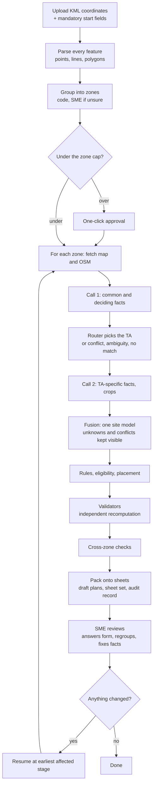

Read it left to right, row by row. The key at the bottom shows which boxes are AI calls, which need a human, and which are plain code.

| Step | What happens | Decided by |
| --- | --- | --- |
| 1 | You upload the KML (coordinates only), fill the four mandatory start fields (road type, speed, traffic volume, lane closure) and may pick a TA in the Select TA dropdown (default Auto). Run is disabled until the mandatory fields are filled | You |
| 2 | Every Point, line and polygon is read and saved, with reasons for any that cannot be used | Code |
| 3 | Work points that must share a plan are grouped into zones. If the system is unsure, it asks | Code, then SME if unsure |
| 4 | The number of zones is compared with one max-zones setting. Under it the run starts; over it waits for one-click approval. Cost estimates are future scope | You set the value |
| 5 | For each zone: fetch the map image and OSM data | Code |
| 6 | Call 1 reads common site facts and the facts that separate the TAs | AI observes |
| 7 | The router picks the TA, or reports a conflict, an ambiguity or no match | Code |
| 8 | Call 2 reads only the TA-specific facts still missing, with crop images | AI observes |
| 9 | Fusion merges all sources into one site model, keeping unknowns and conflicts visible | Code |
| 10 | Eligibility, rules and placement are applied from the rule pack | Code |
| 11 | Validators check each zone, including an independent recomputation | Code |
| 12 | Cross-zone checks look for overlaps between zones | Code |
| 13 | Zones are packed onto sheets (Section 4A). Draft sheets, a sheet set and the audit record are written | Code |
| 14 | The SME reviews, answers the question form, regroups, fixes facts | SME |
| 15 | Any change resumes at the earliest stage it affects | Code |

**Example: the Granite job.** Numbers come from the earlier analysis and are an illustration, not a prediction \[S3\]. The KML has five points, 32 to 39 m apart, about 139 m end to end.

1. Steps 1 and 2 save all five points. None is thrown away.
2. Step 3 sees one road and gaps of 32 to 39 m, all within `merge_max_gap_ft`. With at most three points per zone (the TA-33 start value from your Granite drawing), it proposes two zones, P32 to P31 and P30 to P28, split at the largest gap (39.2 m). The form shows the proposal.
3. Step 4 sees two zones, under the cap, so the run starts.
4. Steps 5 to 8 fetch one map image per zone and make two AI calls per zone, four in total instead of about ten \[S2\].
5. Step 7 checks the expected TA against the facts. Your brief expected TA-33 as a hypothesis \[S1\]. If the facts say otherwise, `TA_SELECTION_CONFLICT` appears on the form and nothing is silently changed.
6. Steps 9 to 13 produce two zone drafts, packed onto sheets per Section 4A, with their audit records. If a tree blocks a sign, the ladder in Section 7 applies.
7. Step 14 lets the SME review each zone, or regroup the points if the grouping looks wrong.

## 4. Intake and grouping (steps 1 to 4)

A work zone is a group of work points that must share one TCP plan, because their traffic control would overlap. The diagram shows how the system decides which points belong together. It was updated in version 4 for the two-pass, case-based rule in Section 4A.

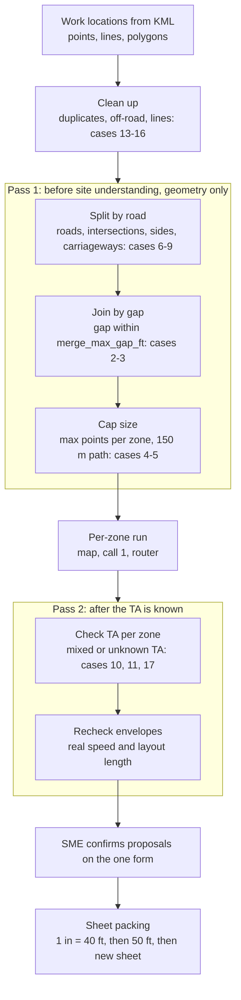

Read it top to bottom. Pass 1 uses geometry only and runs before any paid call. Pass 2 runs after the router and can only propose changes, which the SME confirms. Section 4A explains each step with worked examples.

**Why zones exist.** An SME in AutoCAD looks at the marks on the map and decides whether they are one job or several, then draws one plan per job. The zone is that decision, written down. A zone has exactly one TA. Zones solve a specific problem: points so close on one road that separate sign layouts would pile up.

**Example 1: Granite.** The Granite KML has five poles (P28 to P32) with gaps of 32 to 39 m, which I calculated from its coordinates. In the Granite reference drawing (a different job, see Section 4A) your SME drew one, three or three poles together on a sheet. Merging gives one sign set, one image and about two AI calls instead of five sign sets and about ten calls \[S3\]\[S6\].

**Example 2: E Second Street.** Two manholes, MH 223 and MH FA, 102.5 m apart by my calculation from the KML. Your SME drew them as two sheets: Phase I for MH 223 and Phase II for MH FA, both TA-6 \[S6\]. So two points 102.5 m apart were not merged, even though a rule based on overlapping layouts would have merged them. Phase II adds sidewalk-closure signs (R9-9, R9-11) that Phase I does not have.

**Example 3: two streets.** Points on different roads, or with an intersection between them, never merge. Each zone can then get its own TA, for instance TA-10 on a two-lane street and TA-33 on a divided highway.

**One TA per zone.** A zone is a group of points that share one sign set and one TA. Points that need different TAs are different zones. The TA is only known after site understanding, so the system uses per-point TA or work inputs when you give them. If they are unknown it assumes one TA and asks "same TA for all points?" on the form. After routing, if the site facts imply different TAs along one zone, it flags this and proposes a split. Zones are placed on sheets as described in Section 4A.

The grouping rule and the sheet-packing rule are in Section 4A. They are system settings, not MUTCD values. Until your SME confirms them, multi-zone projects carry `GROUPING_RULE_REVIEW_REQUIRED` and are never SUPPORTED\_AUTO. Single-zone projects are not affected.

**Order of authority for grouping:** a grouping you enter in the UI, then the automatic rule. If neither can decide, the form asks.

**KML content (D-66).** The KML supplies coordinates only: points, lines and polygons. Custom `ExtendedData` keys (`tcp:zone`, `tcp:ta`, `tcp:phase`, `tcp:role`, `tcp:work_description`) and the legacy `selected_ta` key are future scope and are ignored in the MVP. The TA hypothesis, grouping and sheet labels come from the UI only. Placemark names are kept only as display labels (for example "P.13" and "MH 223" on the sheet), never used in decisions (D-72).

**Zone cap.** Before running, the system counts the zones. Up to the configured maximum it runs at once. Above it, it waits for one-click approval. The value is a config setting, set later. Cost estimates and cost caps are future scope because there is not enough usage data yet (D-25).

### The 150 m case: a zone that is too long for the engine

The engine accepts a work path up to 150 m. This is a config setting (`max_work_path_m`) and not a MUTCD rule \[S2\]. Example: seven poles 30 m apart span 180 m, so one zone cannot be built as is.

The catch with splitting automatically: the grouping rule merged those poles because their separate layouts overlap. Splitting creates two zones that overlap at the seam, which is the problem grouping was meant to remove.

| Option | What happens | Gain | Cost |
| --- | --- | --- | --- |
| A. Ask the SME (not chosen) | Flag `ZONE_EXCEEDS_ENGINE_LIMIT`, show a proposed split, SME decides | Safe, no hidden overlap | One more question on the form |
| B. Split automatically with a flag (chosen) | Cut at the largest gap into zones of 150 m or less | No effort | Overlap at the seam; cross-zone check will flag it anyway |
| C. Raise the limit (not chosen) | Change the config after checking image extent, validators and rendering | One real plan for the whole stretch | Engine behavior beyond 150 m is untested and unknown |

**Decision D-19 (yours): option B.** The system cuts at the largest gaps so every piece is 150 m or less. Each piece is flagged `ZONE_SPLIT_AUTOMATIC` and goes to review. The cross-zone check will flag overlap at the seam, which is expected. A line or zone you draw over 150 m is split the same way, not rejected \[S5\]. It is still unknown whether 150 m has any engineering basis beyond the original proof of concept.

## 4A. Sheets: how zones are drawn on pages (steps 3 and 13)

You told me a phase is not a time step. It is the sheet that shows a draft. This section says what your three reference drawings show, and proposes how the system packs zones onto sheets. Everything here is read from the drawings' text and images \[S6\]. The rules are my proposal and need your SME's confirmation.

**What the reference drawings show**

| Job | TA | Sheets | What each sheet shows | Scale |
| --- | --- | --- | --- | --- |
| Colorado St, Mattapan MA (WPI 3168057) | TA-10, with police details instead of flaggers | 1 (Phase I, 1 of 1) | One work point, P13 | 1" = 40' |
| E Second St, South Boston MA (WPI 3171586) | TA-6, with additions | 2 (Phase I and II) | One manhole each: MH 223, then MH FA. Phase II adds sidewalk-closure signs | 1" = 40' on both |
| Granite St (US-1), Westerly RI (WPI 3178233) | TA-33 | 6 (Phase I to VI) | Poles P.32 / P.34, P.33, P.36 / P.37, P.38, P.38-50 / P.39 / P.40, P.41, P.42 / P.42-2. Phase V adds detour signs and an arrow panel | 1" = 40' on I, II, IV and VI. 1" = 50' on III and V |

**What I take from them**

1. Every sheet carries a complete traffic control of its own: advance signs on both approaches, the work vehicle and taper, the buffer, and end-of-work signs.
2. A sheet holds one location, or a small group of neighbouring poles (three in Granite phases II, III and V). Single manholes got their own sheets.
3. The scale steps from 1" = 40' to 1" = 50' when the layout is wider. This matches your wish to show as much as possible together. Whether other scales are used is unknown.
4. Every sheet uses the same template. Fixed elements: the traffic legend, the same 12 general notes, the Type III barricade detail, the drum and cone detail, the free-standing sign detail, the title block, the revisions box, the DigSafe box, a notes box with job-specific lines, a scale bar and a north arrow.
5. There is no cover page. Sheets are numbered "n OF N" in the title block.
6. Add-ons depend on the site and not on the TA: sidewalk-closure signs (R9-9, R9-11L/R, R9-10L, R9-3BR), temporary no-parking (R8-3), police detail, double-fines signs in RI (R2-11 and RI 27.1.1), detour signs (M4-9 series) and an arrow panel. The codes are as printed on the drawings and must be checked against the MUTCD and RIDOT.
7. The speed note differs by job. Boston sheets say "25 MPH unless otherwise posted". The Westerly sheets say "25 MPH as observed in the field".

**A mismatch to resolve.** The Granite KML you gave me is WPI 3159540 with poles P28 to P32. The Granite drawing is WPI 3178233 with poles P.32 to P.42-2. Only P32 appears in both. They may be neighbouring jobs on the same road. I can't check the KML's grouping against that drawing until you confirm or send the matching one.

**Grouping rule: every case, not one number (D-49).** A single distance cannot explain your drafts. The Granite poles about 35 m apart were merged three at a time, while the E Second St manholes 102.5 m apart were drawn on separate sheets. So the rule works from each point's layout envelope, computed from the rule pack, the TA, the speed and the road type, and from a few per-TA settings calibrated on the golden set.

**How it runs, step by step (diagram in Section 4).**

1. **Clean up.** Duplicates under 1 m become one work point (case 13). Lines and polygons become work locations (cases 14 and 15). A point that is not on a road is kept and flagged (case 16).
2. **UI grouping.** If the SME groups points in the UI before running, that grouping is used and the rules are skipped. Pass 2 still checks it. (KML-supplied grouping is future scope.)
3. **Pass 1, geometry only, before any paid call.**
   1. Snap each point to its road and order the points along it. Points on different roads, with an intersection between them, or on opposite carriageways never share a zone (cases 6, 7 and 9). Opposite sides of one road share a zone only for a TA that controls both directions (case 8).
   2. Walk along the road and join consecutive points while the gap is within `merge_max_gap_ft` (cases 2 and 3). When the TA is not yet known, pass 1 uses the TA hypothesis from the UI or KML if there is one, otherwise the smallest `merge_max_gap_ft` of all pack TAs, so it never merges too much.
   3. If a group has more points than `max_points_per_zone` or a path over 150 m, split it at its largest gap, and repeat until every group fits (cases 4 and 5).
4. **Per-zone run.** Map, OSM, call 1 and the router run for each zone.
5. **Pass 2, after routing.**
   1. If points in one zone need different TAs, propose a split (cases 10 and 17). If the TA is still unknown, ask "same TA for all points?" (case 11).
   2. Recompute each zone's layout envelope with the real TA, speed and road type. If two neighbouring zones now qualify to merge, propose it. If their envelopes overlap, keep them on separate sheets.
6. **SME confirms.** Every proposal from pass 2, and anything pass 1 flagged, appears on the one form. Accepting a regroup reruns only the changed zones.
7. **Sheet packing** follows the rule below.

**Worked examples with the start values**

| Job | Input | Pass 1 | Result |
| --- | --- | --- | --- |
| Granite KML | P32 to P28, gaps 32.2, 39.2, 36.4 and 31.7 m (106, 129, 119 and 104 ft) | All gaps are within 150 ft, so one group of 5. That is over 3 points, so split at the largest gap (39.2 m) | Two zones: P32 to P31 and P30 to P28 |
| E Second St | MH 223 and MH FA, 102.5 m (336 ft) apart | Gap over 150 ft | Two zones and two sheets, as your SME drew them |
| Colorado | P13 only | One point | One zone, one sheet |

The ordering problem is solved this way: grouping needs facts that are only known after call 1 (R4), so pass 1 is conservative and pass 2 corrects it.

Per-TA settings in the registry (start values from the golden set, all tunable):

| Setting | Meaning | Start value and basis |
| --- | --- | --- |
| `merge_max_gap_ft` | Largest gap between consecutive work spaces that one continuous closure may bridge | TA-33: 150 ft (the Granite KML poles are 105 to 128 ft apart, and the Granite drawing merged neighbouring poles; its own spacing is not measured). TA-6: below 336 ft (E Second St was not merged); start 150 ft. TA-1 and TA-10: no evidence; start 150 ft, flagged |
| `max_points_per_zone` | Most work points in one zone | 3 for TA-33 (Granite). Others unknown; start 3, flagged |
| `max_zone_path_m` | Longest work path in one zone | 150 m (engine limit, D-19) |

**Case table.** Each case gives one outcome and its flag. Every outcome is shown on the form when it is a proposal.

| # | Case | Outcome | Flag or question |
| --- | --- | --- | --- |
| 1 | One work point | One zone, one sheet | None |
| 2 | Points on one road, same side, same TA, gaps within `merge_max_gap_ft`, count within `max_points_per_zone` | One zone, one closure covering all work spaces | `GROUPING_RULE_REVIEW_REQUIRED` until the settings are confirmed |
| 3 | As case 2 but a gap is larger | Separate zones. If their envelopes overlap they go on separate sheets (as E Second St) | None |
| 4 | More points than `max_points_per_zone` | Split into consecutive groups at the largest gaps | Shown as a proposal |
| 5 | Zone path longer than 150 m | Split at the largest gaps (D-19) | `ZONE_SPLIT_AUTOMATIC` |
| 6 | Points on different roads | Never one zone | None |
| 7 | An intersection between two points on the same road | Never one zone. Side-street signs are added for each zone | None |
| 8 | Points on opposite sides of an undivided road | One zone only if the TA closes both sides' traffic in one layout (TA-10). Otherwise separate zones | Question if the TA is unknown |
| 9 | Points on opposite carriageways of a divided road | Never one zone | None |
| 10 | Neighbouring points need different TAs | Separate zones. One sheet only if both fit and do not overlap | REVIEW\_REQUIRED for a two-TA sheet |
| 11 | TA unknown for some points | Assume one TA and ask "same TA for all points?" | Question |
| 12 | A point at an intersection, work on the crossing road | Its own zone on the crossing road | None |
| 13 | Duplicate points (under 1 m apart) | Merged into one work point, both kept in the record | Warning |
| 14 | A line or polygon | One work location. A line over 150 m is case 5 | None |
| 15 | A point and a line that overlap | Same zone if case 2 holds | None |
| 16 | A point outside any road (yard, landmark) | Kept and flagged. The reference-only toggle is future scope | `NOT_ON_ROAD` question |
| 17 | A zone that changes TA after routing | Second pass proposes a regroup | Question |
| 18 | Grouping entered by the SME in the UI (KML `tcp:zone` is future scope) | The SME grouping wins over all cases above | Conflicts flagged |

**Proposed sheet-packing rule (my answer to your question).**

1. Order the zones along the road. Granite's drawing ascends by pole number while its KML lists the poles in descending order, so the order is the SME's choice. Default: ascending along the direction of travel, reorderable in review.
2. Put the next zone on the current sheet if its whole layout (signs, taper, buffer, end signs) fits at 1" = 40' and does not overlap the zones already on it.
3. If it does not fit, try 1" = 50'. If it still does not fit, or it overlaps, start a new sheet.
4. Two TAs in one project are two zones. They share a sheet only if both layouts fit and do not overlap. No reference drawing shows two TAs on one sheet, so any such sheet is REVIEW\_REQUIRED.
5. Zones on different sheets may overlap along the road, as the two E Second St sheets do. Overlap on the same sheet is an error. This is my reading of your drawings.
6. Sheets are titled "PHASE I", "PHASE II" and so on in order, and numbered "n OF N". The SME can reorder, merge or split sheets in review.

**Title-block data.** The location line uses the road name the POC already prints, so the SME never types an address (D-71). Point labels come from placemark names (D-72). The sheets also show a title, WPI or EWO number, "drawn by", "surveyed by", date and print number. The KML file names contain the WPI number. Where the address and initials come from is open (Section 15).

## 4B. Input schema: what is given, by whom, for every TA and per TA

Inputs fall into three groups. **Mandatory start fields** are typed by the SME in the UI before the pipeline can run. **Asked-if-needed fields** are optional at the start and appear on the one SME form only when a TA rule needs them and nothing else can determine them. **Observed and computed fields** come from the AI calls and from code. The KML supplies coordinates only (D-66). Custom KML tags are future scope.

### Mandatory start fields (D-59, revised again)

The Run button stays disabled until these are filled. They are entered once per project with "apply to all points", and can be changed per point in the location list before running. For the MVP, **no code calculates them and no other source fills them**. The SME's value is the value used. How to make them optional is a future decision.

| Field | Values | Why it cannot be skipped |
| --- | --- | --- |
| `road_type` | Urban (low speed), Urban (high speed), Rural, Expressway/Freeway | Table 6B-1 (MUTCD p. 773) sets advance-sign spacing by this classification, and its footnote assigns the call to the highway agency. TA-6 is limited to low-speed minor roads (TA-6 note 2) |
| `posted_speed_mph` | Number | Taper length (Table 6B-4), buffer (Table 6B-2) and device spacing (Sect. 6K.01) all use it |
| `traffic_volume` | High or Low | TA-6 9 ft option (note 4) and TA-10 single flagger (note 2) |
| `lane_closure` | Yes or No | The main router input that separates TA-1 and TA-6 from TA-10 and TA-33 |

**Traffic control method is not a start field (D-68).** `traffic_control_method` stays in the data model but is not asked in the UI. It is set by code only when it is needed: when the router picks TA-10, it is set to Flagger, and the draft uses the standard MUTCD TA-10 layout with flaggers, the W20-7 Flagger sign and the flagger tapers. Police details are a state-level choice that replaces the flaggers and changes the sign to POLICE OFFICER AHEAD. In the MVP the SME makes that switch after the draft exists, as a review action through the SME assistant (Section 8). Other methods (AFAD, signals) are future scope.

**When a computed check disagrees with a mandatory value**, the system never changes the value. It raises a conflict on the SME form instead. Example: the SME enters `lane_closure` = No, but the computed remaining lane width is 8.5 ft. The form says "the computed remaining width of 8.5 ft is below the 9 ft minimum; this needs a lane closure, but you entered No. Change the answer or explain." The SME decides.

**Future automation candidates (documented, not built).** Traffic volume and the urban/rural part of road type could later come from FHWA HPMS, MassGIS and RIDOT road inventories (AADT and functional class) and Census urban-area boundaries. Speed could come from OSM `maxspeed` or Azure Maps attributes. None of these is used in the MVP.

### Asked-if-needed fields

| Field | Meaning | When it is asked | MUTCD reason |
| --- | --- | --- | --- |
| `duration` | Short-duration or mobile, short-term, intermediate, long-term | When the chosen TA has a duration option | TA-1 note 4, TA-6 note 10 and TA-10 note 3 allow fewer signs, or no taper and devices, for short or mobile work |
| `night_work` | Work at night | When the TA has a night rule | TA-10 note 7: flagger stations must be lit at night |
| `heavy_vehicles` | Longer and wider commercial vehicles present | When the remaining lane width falls between 9 and 10 ft | TA-6 note 4 |
| `arrow_board_wanted` | SME wants an arrow board where it is optional | Never forced. Offered on the form | TA-33 note 7 makes it mandatory on freeways |
| `ta_hypothesis` | "Select TA" dropdown in the UI: Auto, TA-1, TA-6, TA-10, TA-33 (D-73) | Optional at start, per project and per point. Default Auto | Checked against facts, never trusted alone. A mismatch gives `TA_SELECTION_CONFLICT` (Section 6) |
| `work_side` | Left or right of the direction of travel | Always: the AI suggests it and the SME confirms it on the form (D-69) | Decides which approach gets which signs and which lane closes |
| `work_type` | Pole, manhole, excavation, trench | When the footprint is not visible | Sets the default footprint |
| `work_space_length_ft` | Length of the work area along the road | For single points when not derivable (open question G3) | Activity area, Sect. 6B.06 |
| `reduced_work_zone_speed_mph` | A temporary regulatory speed through the zone | When a jurisdiction module needs it (RI double fines) | Sect. 6G.08 |
| `vehicle_detour_required`, `pedestrian_detour_required` | A detour is part of the plan | When the site shows a full closure or a closed sidewalk | Triggers the detour module |
| `pedestrian_accessible_route_maintained` | An accessible path exists when a sidewalk closes | When the sidewalk is affected | Accessibility of the pedestrian route |
| Title block: `wpi_number`, `client_name`, `digsafe_ticket_number`, location | Printed on every sheet | Before the PDF is produced | The location line uses the road name the POC already prints, from the same source; the SME does not type an address (D-71). Point labels come from placemark names (D-72) |

**Why `duration`, `night_work` and the other fields you listed are kept (reverses the earlier D-55).** MUTCD options depend on them. Dropping `duration` would remove three shortcuts your SME may use on short jobs: TA-1 note 4 (signs and devices may be omitted for short-term, short-duration or mobile work with a lit vehicle), TA-6 note 10 (taper and devices may be omitted for short-duration work with a lit shadow vehicle), and TA-10 note 3 (first and last signs may be omitted for short-duration work). Without them every short job would get the full layout, which is more than your SME draws today. `night_work` drives the TA-10 standard that flagger stations are lit at night. The other fields you named (lane closure, flagger or police preference, heavy vehicles, arrow board) each change a rule result. None of them can be read from imagery or open data, so each stays a UI answer, asked when the system cannot determine it.

### Observed and computed fields

**Lengths are computed by code, never typed by the AI (D-64).** The AI returns image positions: the pixel coordinates of road edges, lane lines, curbs, the work point and objects. Code converts them to feet with the image's ground scale and computes every length. Lengths along the road (gaps between points, path length, distance to a side road, curves) come from the KML coordinates and the road centerline geometry, also by code. This is more accurate and fully auditable: the same inputs always give the same number, and the uncertainty comes straight from the pixel size (Section 5, D-38).

| Field | How it is obtained |
| --- | --- |
| `lanes_per_direction`, `oneway` / `direction_of_travel` | AI observation, cross-checked with OSM and state road data |
| `lane_width_ft`, `shoulder_width_ft`, `median_width_ft`, `distance_from_edge_ft` | Code, from AI-marked edge positions |
| `encroachment_depth_ft`, `remaining_lane_width_ft` | Code. Measured to the near face of the channelizing devices (TA-6 note 1) |
| `shoulder_present`, `divided_highway`, `median_work`, `bicycle_lane_present` | AI observation, cross-checked with OSM and state data |
| Sidewalk presence and side, on-street parking, bus stops, driveways, crosswalks | AI observation, plus OSM and GTFS feeds |
| Intersections and side roads in the zone, grade crossings | Code, from OSM, state data and the FRA crossing inventory |
| `curve_or_crest_near_zone` | Code, from centerline curvature and USGS 3DEP elevation |
| Obstructions (trees, poles, walls, parked vehicles) | AI observation |
| `work_side` suggestion | AI, confirmed by the SME on the form (D-69) |
| `jurisdiction` | Code, from the coordinates |

### Per-TA schema (asked only for the chosen TA)

| TA | Field | Meaning | Source | MUTCD citation |
| --- | --- | --- | --- | --- |
| TA-1 | `distance_from_edge_ft` | Distance of the work space from the roadway edge or curb | Code | Fig. 6P-1 note 3 (sign may be omitted at 15 ft or more, behind a barrier, or more than 24 in behind the curb) |
| TA-1 | `behind_barrier` | Work space is behind a barrier | AI | Note 3 |
| TA-1, TA-33 | `median_work` | Work in the median of a divided highway | AI | TA-1 note 1 (sign also on the left), TA-33 note 1 |
| TA-6 | `shoulder_present` | Must be true for TA-6 | AI | Figure title (shoulder work) |
| TA-6 | `shoulder_width_ft`, `remaining_lane_width_ft` | Widths | Code | Note 1 (10 ft minimum to the device face) |
| TA-6 | `opposite_shoulder_suitable` | Opposite shoulder can carry shifted traffic | AI, else SME | Note 5 |
| TA-10 | `traffic_control_method` | Flagger by default; police by SME after the draft | Code, then SME review action | Fig. 6P-10; police is a state-level variant |
| TA-10 | `single_flagger_eligible` | Low volume, short zone, straight road, flagger visible both ways | Code for straightness and length, `traffic_volume` from the SME | Note 2 |
| TA-10 | `approaching_lanes_one` | Only one approaching lane per controlled direction | AI and OSM | Note 5 (condition for AFAD) |
| TA-10 | `curve_or_crest_near_zone` | A curve or hill crest near the taper | Code | Note 6 (extend the buffer) |
| TA-10 | `grade_crossing_present` | Rail or transit grade crossing in or upstream of the zone | Code (FRA, OSM) | Notes 9 to 13 |
| TA-33 | `divided_highway`, `lanes_per_direction` | Road form | AI and OSM | Figure title; Sect. 6N.11 |
| TA-33 | `closed_lane_side` | Right lane or median-side lane | AI, else SME | Note 1 (median side uses LEFT LANE CLOSED and the left lane-ends sign) |
| TA-33 | `lanes_closed_count` | Number of lanes closed | AI, else SME | Note 7 (one arrow board per closed freeway lane) |
| TA-33 | `shoulder_closed_ft` | Paved shoulder width closed | Code | Note 3 (8 ft or more needs devices) |
| TA-33 | `freeway` | Derived from `road_type` = Expressway/Freeway | Code | Note 7 |
| TA-33 | `side_road_in_zone` | Side road inside the zone | Code | Note 2 (standard) |
| TA-33 | `median_width_ft`, `positive_barrier_present`, `ramp_present` | Median and interchange context | Code, AI | Placement and buffer decisions |

**Diagram:** how the three groups reach the rule pack.

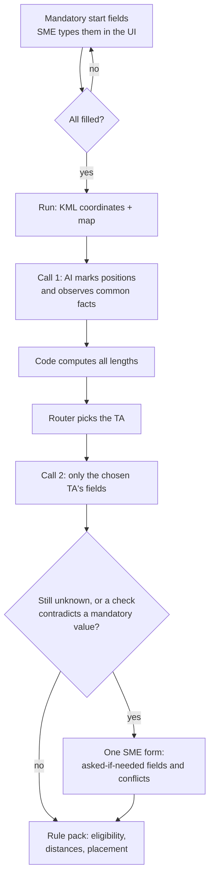

**Open item.** Your SME should confirm nothing required is missing, especially for TA-1, which has no reference draft yet.

## 4C. Pre-calculation: what the system works out before asking the SME

Everything here is computed by code from AI-marked positions, the KML and open data, with a source and confidence on every value. None of it touches the mandatory start fields, which come only from the SME in the MVP.

### 1. Vehicles, shadow vehicle, TMA and arrow board

| Fact | How it is computed |
| --- | --- |
| `work_vehicle_present` | True for any active work. Not asked |
| `work_vehicle_width_ft` | Measured from imagery when a vehicle is visible. Otherwise a cited default width from config, flagged `DEFAULT_ASSUMED` (open question on the default value) |
| `shadow_vehicle_present` | Required when `duration` is short-duration or mobile and the layout omits the taper and devices (TA-1 note 4, TA-6 note 10). Otherwise optional and off by default (TA-6 note 8) |
| `tma_present` | Always optional in the MUTCD (TA-6 note 9, TA-33 note 4). Proposal: suggest one at 45 mph or more as a labelled client safety policy, `POLICY_SUGGESTED` (open question) |
| `arrow_board_present` | Mandatory when `freeway` is true, one per closed lane (TA-33 note 7). Otherwise only if `arrow_board_wanted` |

### 2. Lane width and the lane-closure check

```
encroachment_depth_ft   = how far the work space, vehicle, equipment and the
                          near face of the channelizing devices extend into the
                          travel lane (measured to the device face, TA-6 note 1)
remaining_lane_width_ft = lane_width_ft - encroachment_depth_ft
```

Both are computed by code from AI-marked edge positions. When the work space is not visible yet, the footprint uses the `work_type` default and the cited vehicle width, flagged `DEFAULT_ASSUMED`.

| `remaining_lane_width_ft` | Heavy vehicles | Volume and speed | Result |
| --- | --- | --- | --- |
| 10 ft or more | any | any | TA-6 can hold (note 1) |
| 9 to 10 ft | no | low volume, low speed | TA-6 can hold under the 9 ft option (note 4), labelled on the plan |
| 9 to 10 ft | yes or unknown | any | A lane closure is needed |
| Under 9 ft | any | any | A lane closure is needed |
| Within the uncertainty band of a boundary | — | — | UNKNOWN; the SME confirms or enters a measured width |

`lane_closure` is a mandatory SME answer, so this table never changes it. If the result says a closure is needed and the SME entered No, the form shows the conflict described in Section 4B. The TA change, if the SME agrees, follows the normal TA-change flow (Section 6).

### 3. Road type and speed prior: future scope

The lookup from OSM and state tags to a suggested road type and speed band (for example `highway=secondary` inside an urban area suggesting "Urban, 25 to 35 mph") is moved to future scope (D-58 deferred). In the MVP both values are typed by the SME with no pre-fill.

### What is computed instead of asked

| Field | Computation | Goes to the SME only when |
| --- | --- | --- |
| All lengths and widths | Code, from AI-marked positions and geometry | The value sits within the uncertainty band of a threshold |
| `remaining_lane_width_ft` | Recomputed after every placement change | It contradicts the SME's `lane_closure`, or sits in the uncertainty band |
| `shadow_vehicle_present`, `arrow_board_present` | From `duration`, `road_type` and the TA rules | Never asked |
| `tma_present` | From the speed policy threshold | The SME can always override |
| `lanes_per_direction`, `shoulder_present`, `divided_highway` | AI, cross-checked with OSM and state data | Imagery and data disagree |
| Side roads, grade crossings, bus stops, curves and crests | Code, from OSM, FRA, GTFS and USGS 3DEP | The data is incomplete near the site |

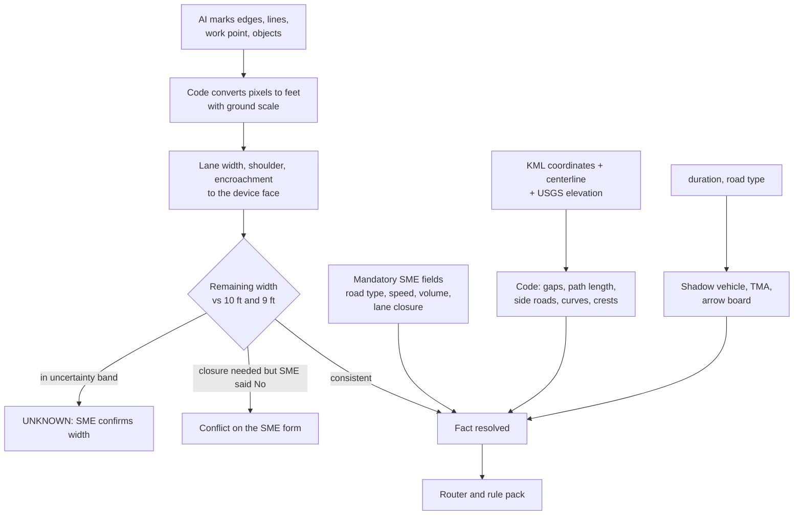


## 5. The pipeline for one zone (steps 5 to 11)

The AI observes twice, and code decides everywhere else. The diagram shows the stages that run for each zone, and what each one produces.

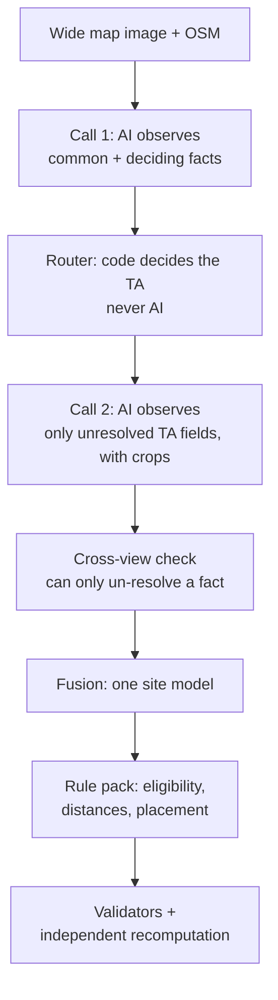

Read it top to bottom. The text on the right says what each stage does and what it must not do.

**The two AI calls**

|  | Call 1 | Call 2 |
| --- | --- | --- |
| Purpose | Wide read of the site | Fill the gaps for the chosen TA |
| Input | Wide image, KML geometry, known facts, project inputs | Targeted crop images, the facts already resolved, the chosen TA's missing fields |
| Output | Common facts, the facts that separate the TAs, and image positions of edges, lines and objects. Never a length in feet (D-64) | Only the TA fields still unknown, as positions or observations |
| Rule | Unknown stays unknown, never guessed | Never overwrites a resolved fact. The cross-view check can only un-resolve a fact |

Folding the TA fields into call 2 saves one AI call per zone and keeps the two-call budget the repo already has \[S3\]\[S5\]. The trade-off is that a confident mistake in call 1 survives unless the cross-view check catches it. Safety-critical facts therefore always go through that check.

**AI output format (D-61, test before building).** A schema with one property per fact, each nullable, failed in Azure Foundry once it passed about 15 fields. Anthropic's documented limits for strict schemas are at most 20 strict tools, 24 optional parameters and 16 union-type parameters (`anyOf` or `["string","null"]`) per request, plus an internal grammar-size limit that returns "Schema is too complex for compilation". The proposed design:

- One flat list: `facts: [{field, value, unit, status, confidence, evidence}]`. Every property required, `value` always a string parsed by code, `status` an enum (RESOLVED, UNKNOWN, CONFLICT) instead of null. The grammar size stays the same however many facts there are.
- No `minimum`/`maximum` in the schema; ranges are checked in code. Enum values are compared without regard to case.
- A fact that is missing or malformed becomes UNKNOWN.
- Fallback on a 400 "too complex" error: retry once without strict mode and validate in code.

JSON only (your decision). TOON is not used. The S0 spike compared the two variants (`spikes/schema_spike/REPORT.md` on branch `tcp-mvp/s00-schema-spike`): the current per-property schema was rejected by Foundry (23 union-type parameters; with the 18 call 1 fields added, 24; limit 16), and the facts list was accepted and schema-valid in 9 of 9 calls. D-61 is decided: the flat facts list. The spike findings that shape S6 and S7 are D-80.

**Confidence thresholds.** The POC used 0.70 for common facts, and that carries over as a starting value. New TAs start at 0.80 for safety-critical facts \[S1\]. The router package suggests 0.85 for auto-routing \[S3\]. All of these are set per field in the registry, not hardcoded. The router's own starting values are in Section 6.

**Facts imagery cannot give.** Road type, speed, traffic volume and lane closure are mandatory start fields typed by the SME (Section 4B). Duration, night work and the other asked-if-needed fields go on the form only when a rule needs them \[S3\].

**Crops and image size (D-27).** The wide image gives context and crops give detail. Vision models shrink any image over their input limit, automatically, and small features (driveway edges, lane lines, small signs) disappear first. A crop fits inside the limit, so nothing is shrunk. Code therefore resizes every image to the deployed model's limit before sending, so the model sees exactly what is hashed and stored. That limit is unknown and is in the verification prompt.

Cropping in code adds no new detail, it only enlarges pixels. From the figures reported in \[S2\] (about 424 m across at 1280 px), one pixel covers about 0.33 m. A 60 m crop is then only about 180 px wide. That is my arithmetic, not a measurement. The hybrid rule: crop in code first. If a crop has too few pixels to read a feature, fetch a higher-zoom image from Azure Maps for that crop only, up to the imagery's own limit. "Enough pixels" per feature type is a setting to calibrate. Each fetched view gets its own signature and is stored as evidence. Whether Azure Maps terms allow storing derived imagery is unknown and must be checked.

**Road geometry sources (D-37).** Road geometry is fused from several sources: MassDOT, OSM and others still to be named. Your SME says these vector sources are often inaccurate, so every fused geometry value is stored as low confidence. The AI compares the imagery with the best fusion result and identifies what is true. A disagreement is recorded, never hidden. Which other sources are used, and where MassDOT data does not cover a site, is unknown.

**Final source selection (D-53, revised).** Open-source and public data, plus Azure Maps, which is allowed because the project already holds an API for it. These sources serve the observed and computed fields only. They never fill the mandatory start fields in the MVP.

| Source | License or access | Supplies |
| --- | --- | --- |
| Azure Maps | Existing project API | Imagery (as today), reverse geocoding for the title-block address if wanted (open question G6), and any road attributes its API returns (to be checked in S0) |
| OpenStreetMap via Overpass | ODbL, free | `highway`, `ref`, `name`, `maxspeed`, `lanes`, `lanes:forward`/`backward`, `oneway`, `width`, `shoulder`, `sidewalk`, `cycleway`, `parking:*`, `highway=crossing`, `railway=level_crossing`, `highway=bus_stop`, `highway=traffic_signals`/`stop`, `service=driveway`, `dual_carriageway`, `barrier`, plus the urban boundary and land use around the site |
| MassGIS / MassDOT road inventory | Massachusetts public data | Centerlines, functional class, lanes, lane and shoulder width, median, AADT. Attribute names to be verified in S0 |
| RIGIS / RIDOT layers | Rhode Island public data | The same for RI jobs. Attribute names to be verified in S0 |
| FHWA HPMS | Federal, public | Functional class, urban code, AADT, speed limit, lanes. Federal-aid roads only |
| US Census TIGER urban areas | Public domain | Urban or rural boundary |
| USGS 3DEP elevation | Public domain | Grade and hill crests (TA-10 note 6) |
| MBTA and RIPTA GTFS feeds | Open | Bus stops near the zone |
| FRA grade-crossing inventory | Public | Rail and transit grade crossings |
| City open data (for example Analyze Boston) | Municipal open data | Only when a job needs more detail |

**Dropped:** Google Street View (commercial, metered), Mapillary for geometry (photos only), assessor parcel GIS (marginal gain), client as-builts (not open; project evidence only), MPO data (overlaps). Fusion weights still follow D-37: every source is low confidence until checked against imagery, and disagreements are recorded.

**Road width and its uncertainty (proposal D-38, awaiting your approval).** The likely method, unverified \[S2\]: the AI marks road edges on the image, code converts pixels to meters using the ground scale, and lane width is derived from road width and lane count. At about 0.33 m per pixel, one pixel of error on each edge is about 0.65 m (2 ft). I would expect roughly 1 to 2 ft of error in good conditions. That is my estimate. TA-6 turns on a 10 ft or 9 ft remaining lane width \[S3\], a difference smaller than the likely error. Proposal: store every width with an uncertainty (for example 9.8 ft plus or minus 1.5 ft), run the rules on the whole interval, and if a threshold falls inside it set the fact to UNKNOWN so the form asks the SME for a confirmed or measured width. Fetch a finer cross-section view when needed (the hybrid crop rule). Calibrate the uncertainty against the widths on your reference drawings.

**Example.** A manhole zone on a two-lane road. Call 1 reports two lanes, undivided, no shoulder, manhole in the lane. It cannot say whether a lane will close. The router stops and the form asks "Will a travel lane be closed?" The answer arrives as an SME-labelled input, the router resumes, and call 2 then fills only the TA-specific gaps, such as sight distance.

## 6. The router: how the TA is chosen (step 7)

The router is plain code that compares site facts with the rule pack's eligibility conditions and returns one of five outcomes. Think of a triage desk: it reads the facts and sends the case to the right department, or says there is none.

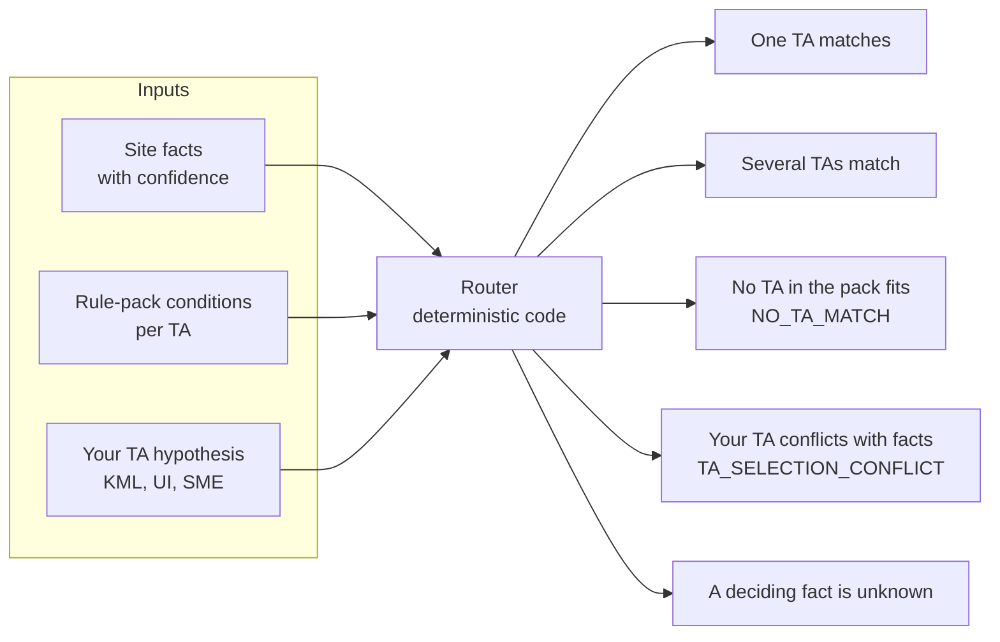

Three kinds of input go in on the left. Exactly one of the five outcomes comes out on the right.

**Why it matters.** The POC pipeline was fixed to TA-1 \[S3\]. The router lets the same pipeline serve several TAs, and it keeps the audit trail clean because the TA comes from a rule id and source, not from a model's opinion.

**Facts the router needs.** The 15 common fields cannot separate TA-6, TA-10 and TA-33, so about nine deciding fields are added \[S3\]:

| Deciding fact | Why it matters | Where it comes from |
| --- | --- | --- |
| `work_location` (beyond shoulder, on shoulder, encroaching, in lane, median) | Separates TA-6 from lane closures | Imagery plus work description |
| `lane_closure_required` | Separates TA-6 from TA-10 and TA-33 | Work description or SME |
| `alternating_traffic_required` | TA-10 | Work description or SME |
| `lanes_per_direction` | TA-33; total lane count is not enough | Imagery |
| `shoulder_present`, `shoulder_width_ft` | TA-6 and TA-33 | Imagery |
| `remaining_lane_width_ft` | Decides whether TA-6 holds (10 ft, or 9 ft by exception) or becomes a lane closure | Computed from road width and encroachment |
| `traffic_control_method` | Set by code to Flagger when TA-10 is chosen. Police detail is applied by the SME after the draft (D-68) | Code; SME review action |
| `traffic_volume` | The 9 ft option and the single-flagger option depend on it | SME or project input |

**No match and near match (D-35).** The router reasons only about TAs that exist in the rule pack. TA-3, TA-11 and TA-12 appeared in the earlier analysis from VS Code Claude's general knowledge, not from the pack \[S3\], so the router never names them.

| Situation | Router answer |
| --- | --- |
| One pack TA has all conditions met | That TA |
| No pack TA fits | "No TA in the current rule pack fits this site", with the failed conditions listed per TA. No TA outside the pack is named |
| A pack TA is close | "Did you mean TA-X?" with the failed and unknown conditions shown |
| A TA is added to the pack later | It takes part automatically |

**Starting values (D-33, delegated to me).** These are registry settings, not regulatory values, and they are tunable. I started strict because a wrong automatic pick costs more than one extra question. After the real KML runs, review how often questions appear and adjust.

| Setting | Start value | Basis |
| --- | --- | --- |
| Auto-select a TA | Exactly one TA matches, all deciding facts resolved, confidence at least 0.85 | Package suggestion \[S3\] |
| Safety-critical facts for new TAs | At least 0.80 | Your brief \[S1\] |
| Common facts | 0.70 | The POC value, carried over |
| "Did you mean" | At most one failed condition, any number of unknown ones, at most two suggestions | My proposal |

**Speed source (D-34 superseded by D-59).** Speed is a mandatory start field typed by the SME. In the MVP no other source fills or checks it. The earlier source order (project input, posted-speed evidence, OSM `maxspeed`) and the jurisdiction default are future automation candidates.

**Routing decision tree (D-60).** With the facts resolved, the router follows this tree. Only TA-1, TA-6, TA-10 and TA-33 exist in the MVP. Anything else returns "No TA in the current rule pack fits this site".

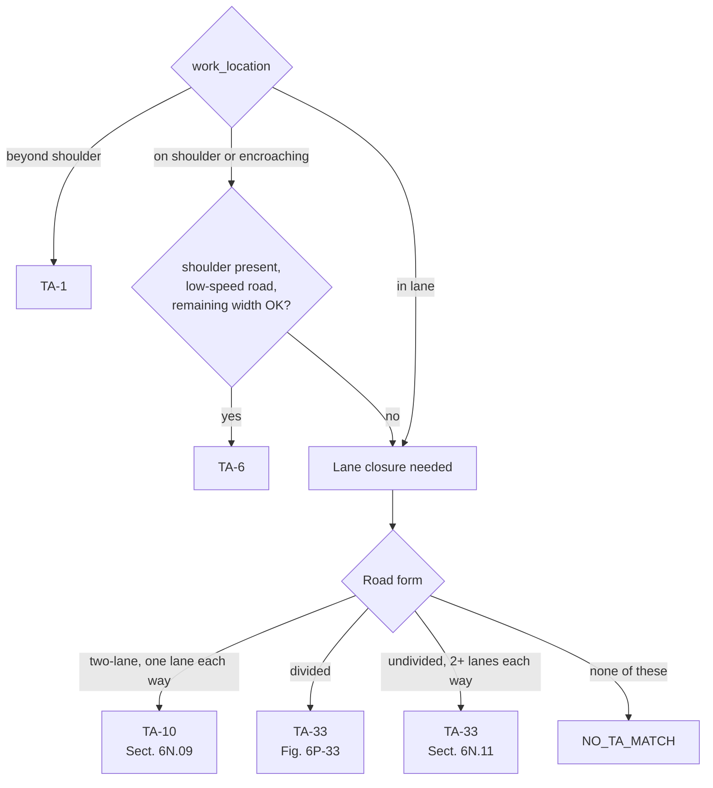

**Eligibility rules made explicit (D-60).**
- TA-6 requires `shoulder_present` = true. The figure is "Shoulder Work".
- TA-6 requires a low-speed minor road. TA-6 note 2 says the treatment is for minor roads with low speeds and higher speeds should use a lane closure. The condition uses the SME's `road_type` and `posted_speed_mph`. The exact speed cutoff is a rule-pack value that needs a source, marked `SOURCE_REVIEW_REQUIRED` until your SME sets it.
- TA-6 remaining width is measured to the near face of the channelizing devices (note 1).
- TA-33 is one rule with an OR: divided highway, or undivided with two or more lanes each way (Sect. 6N.11). It is never two separate checks, so the router cannot double-match.

**What the MUTCD figures show, and what your drafts do.** From the Chapter 6 file you supplied \[S6\]:

| TA | MUTCD figure (11th Ed., Dec 2023) | Signs per approach in the figure | Your drafts |
| --- | --- | --- | --- |
| TA-1 | 6P-1, Work Beyond the Shoulder | W20-1. Note 2 allows SHOULDER WORK instead. Note 3 allows omitting it behind a barrier, more than 24 in behind the curb, or 15 ft or more from the roadway | No reference draft yet |
| TA-6 | 6P-6, Shoulder Work with Minor Encroachment | W20-1, shoulder taper 1/3 L, optional buffer, optional G20-2. Note 1: lanes at least 10 ft. Note 6: ROAD NARROWS may be added | E Second St: W20-1, W21-5, W5-1 labelled 100 ft MIN, plus no-parking and sidewalk signs |
| TA-10 | 6P-10, Lane Closure on a Two-Lane Road Using Flaggers | W20-1, W20-4, W20-7 at A, B, C spacing, 50 to 100 ft tapers, optional G20-2 | Colorado St: W20-1, W20-4 and POLICE OFFICER AHEAD at 100 ft, police details instead of flaggers |
| TA-33 | 6P-33, Stationary Lane Closure on a Divided Highway | W20-1, W20-5R, W4-2R, arrow board, merging taper L, optional buffer, optional G20-2. Section 6N.11 allows a similar layout on undivided or divided four-lane roads when the right lane is closed | Granite St (US-1): W20-1, W20-5R, W4-2R at 100 ft, plus RI double-fines signs |

The router must follow your SME's practice, not only the figure titles. Granite is not a divided highway, but Section 6N.11 allows TA-33 there. The TA-33 eligibility in the pack must cite 6N.11 as well as the figure, or the router would refuse Granite.

**Reference drawings for each TA (from you).** TA-6: E Second St, South Boston MA, a shoulder closure with some additions. TA-10: Colorado St, Mattapan MA, flagging with alternating traffic, here with police details instead of flaggers, a common change. TA-33: Granite St (US-1), Westerly RI, used where there is no shoulder. TA-1: no reference draft yet. Please send one \[S6\]. The expected TA for each job is a test expectation, never an input.

The working summary from the analysis is: TA-33 is a divided highway with a lane closed; TA-10 is an undivided two-lane two-way road with one lane closed and alternating traffic; TA-6 is shoulder work with minor encroachment and no lane closed \[S3\]. The real conditions are encoded from the source text in the rule pack, with a source for each, and not copied from this summary.

**If you choose a TA and the facts disagree.** The system shows both sides before anything proceeds: your TA, the TA the router found, the supporting facts, and the failed conditions. The SME then switches, keeps your TA as a recorded exception with a written reason, or marks the TA undetermined. Eligibility is never weakened to make a site fit.

**Example.** You choose TA-33 for a street that is undivided. The router reports `TA_SELECTION_CONFLICT`, lists "divided highway: failed" with the evidence, and puts the question on the form. Nothing is changed silently.

## 7. Conflicts, exceptions and work outside any TA (steps 10 and 11)

When something on site blocks the standard layout, the system works down a fixed ladder and stops at the first step that works. Most obstructions are a placement problem, not a TA problem \[S4\].

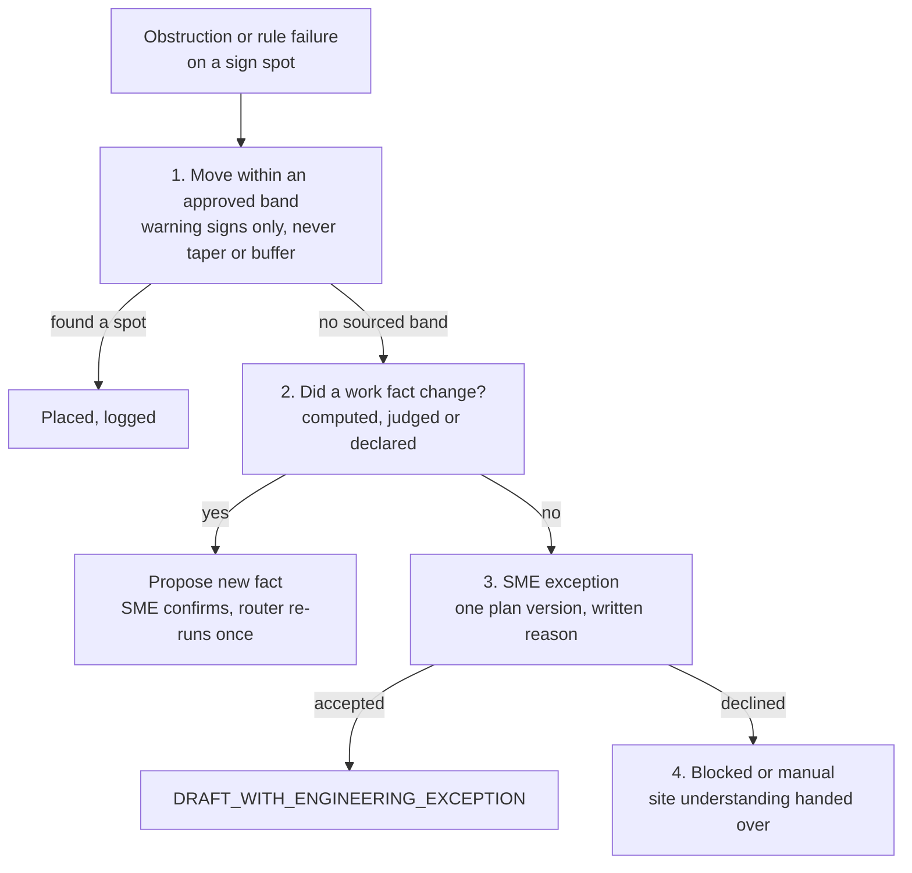

Read it down the left column. Each step either ends in a result on the right, or hands over to the next step.

**The ladder, with a tree where a sign should go**

1. **Move within an approved band.** Code searches along the road for the nearest clear spot, preferring upstream so warning distance is not reduced. It keeps the sign on the correct side and logs the rule distance and the actual distance. No AI and no question. Your SME allows a sign to be placed at a nearby available space. The taper and the buffer must be accurate, so the automatic search never moves them and no pre-approved band exists for them. The SME can still move them by hand during review. That move is recorded as a one-off exception for that plan version, and is never offered as a pre-approved entry or a candidate for promotion (D-24, my reading of your clarification).  The size of the allowed sign shift is still unset \[S5\].
2. **Did a work fact change?** Moving a sign never changes the TA. Only a change to the work itself does. The system proposes the new fact, the SME confirms, and the router runs once more.
3. **SME exception.** The SME knowingly accepts a rule failure for this plan version only, with a reason. A failure is never turned into a pass \[S4\].
4. **Blocked or manual.** The saved site understanding, conflicts and imagery are handed over.

**How a work-fact change is detected**

| Kind of change | How it is detected | Who confirms |
| --- | --- | --- |
| Computed (remaining lane width after the work area moves) | Code recomputes derived values when a placement or work area changes, then re-runs the router conditions. A change counts when a value crosses a limit in some TA's conditions | Nobody, it is arithmetic |
| Judged (a tree on the shoulder forces the crew into the lane) | Code detects that the obstruction overlaps the intended work area. Whether the crew really moves into the lane is a judgment, so it raises a question | SME |
| Declared (user or SME edits an input) | The input comparison changes the reuse signature, and the run resumes at the earliest affected stage | The person who edited it |

Whether the current code can recompute these automatically is unverified. It is in the prompt for VS Code Claude (Section 18).

**Examples**

| Situation | Fact that changes | Result |
| --- | --- | --- |
| Tree blocks the sign spot | None | Ladder step 1 or 3, same TA |
| Tree on the shoulder pushes the work vehicle into the lane | `work_location`: on shoulder to in lane | Proposed change from TA-6 to a lane-closure TA (TA-10 or TA-33), SME confirms |
| Encroachment leaves under 10 ft of lane | `remaining_lane_width_ft` | TA-6 to lane closure (TA-10), SME confirms |
| Driveway inside the work area | None, it is a conflict | TA stays, extra devices or an exception |
| No room for a flagger station | `traffic_control_method` | TA-10 no longer matches, ladder step 3 or 4 |

The router may re-run at most once. If the result keeps switching, it goes to review.

**The obstruction check, for all TAs.** The POC's sign-conflict check looks only at driveways, intersections, crosswalks, roundabouts and ramps, and ignores the obstructions the AI detects (trees, poles, walls, parked vehicles) \[S4\]. A sign on a tree would pass. The MVP applies `GEO-SIGN-OBSTRUCTION` to every TA from the start. Low-confidence obstructions go to the SME and are never acted on automatically.

**What counts as a work-fact change (clarification).** A work fact is an input to the rules: lane width, encroachment, shoulder width, work side, and so on. Sign placement is the output. A sign moving is never itself a work-fact change. Step 2 asks one question: was an input used to compute this wrong? It is a correction step, not a way to avoid asking for an exception. Mandatory start fields can only be changed by the SME.

*Example 1, wrong width.* Remaining lane width is computed at 9.5 ft, which forces the tight layout, and its channelizer line hits a parked car. The SME checks and the encroachment is really 2 ft, not 3 ft, so the width is 10.5 ft. Recomputing removes the tight layout and the conflict. That is a work-fact change.

*Example 2, wrong speed.* The SME typed 45 mph, so W20-1 is placed far upstream and lands on a tree. The SME sees the speed sign actually reads 35 mph and corrects the field. The spacing shrinks and the sign clears the tree. Because speed is a mandatory field, only the SME can make this change; the system only points at the conflict.

*Not a work-fact change.* The tree is really there, the speed and width are correct. Nothing was wrong, so step 2 finds nothing and the ladder goes to step 3, an SME exception.

**Where approved adjustments come from.** The allowed shift for each device is data in the rule pack (Section 10), taken from the best available source: MUTCD text, a jurisdiction manual, an approved project plan, or an SME-approved setting. If the source text does not set a limit, the number is not invented. It stays empty and marked `SOURCE_REVIEW_REQUIRED`, and the SME is asked in real time. The answer is saved as a one-off exception for that plan version, and can be proposed to governance as a future pre-approved entry.

**SME approval gate (D-65).** Config `require_sme_approval_for_all_plans`, default `true` for the MVP. Every plan stops at a draft and waits for an SME click, whatever its confidence. The system still computes whether it would have been SUPPORTED\_AUTO and shows that for information. Setting the flag to `false` lets a genuinely SUPPORTED\_AUTO plan finish without a click; review-required and exception cases always stop. The flag lives in project or registry config, so it can change per client without a code change.

**Status labels.** "Compliant with field adjustment" is used only when the band has an authority source. Otherwise the plan carries an engineering exception.

| Status | Meaning |
| --- | --- |
| `DRAFT_COMPLIANT` | Standard placement, all checks pass |
| `DRAFT_COMPLIANT_WITH_FIELD_ADJUSTMENT` | Moved within a sourced band |
| `DRAFT_WITH_ENGINEERING_EXCEPTION` | SME accepted a recorded failure |
| `BLOCKED` | Needs a human; site understanding handed over |

The project and zone status vocabulary from Section 13 maps onto these. Only `DRAFT_COMPLIANT` can be SUPPORTED\_AUTO.

**This plan version only (D-29, decided).** An exception is attached to one immutable plan version. If a change creates a new version (new facts, regrouping, a TA change, a rule-pack update), the exception does not carry over. The system re-checks, and if the same conflict appears it asks again. An old approval can't silently cover a layout the SME never looked at. You chose to offer a one-click "Same as version 3, reuse?". It requires an exact match (same object, failed check, distance, facts and pack version) and is still logged as a new approval. If anything differs, the system asks again.

**Work that fits no TA.** The router returns `NO_TA_MATCH` with the exact failed conditions. The SME can use the closest TA as a recorded exception, take the job manual with the site facts handed over, or, later, use an engineer-designed plan (Section 16). After any adjustment, the cross-zone and image-extent checks run again.

**Learning from exceptions.** Every exception stores its action, reason and failed check. A report groups them by reason. A pattern that keeps recurring becomes a proposed rule-pack change. The SME proposes it and a named approver role approves it (D-28), then the pack is re-hashed. Who holds the role at the client is unknown, and the state store needs a user and role model for it. The AI never changes rules, and a promoted entry carries its own authority label and is never promoted into the federal layer \[S1\].

## 8. SME questions and review (step 14)

Everything the system cannot decide or cannot know arrives together on one form, and the answers resume the run instead of restarting it. The diagram shows the loop and a sub-question example.

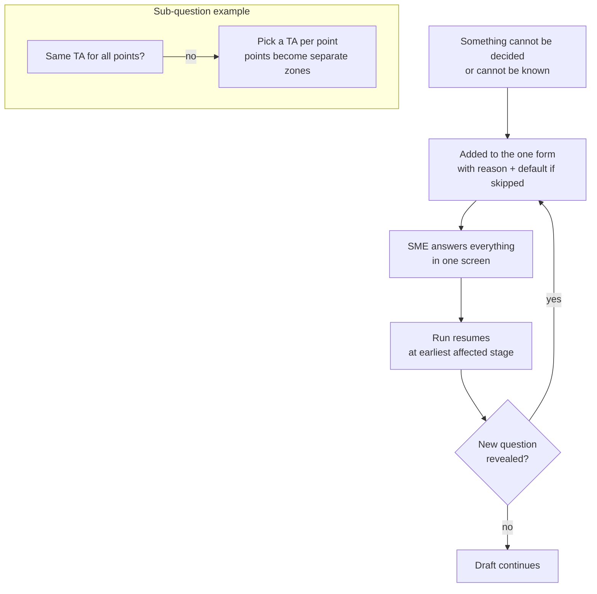

The top two rows are the loop. The middle block shows how one answer reveals more questions on the same form.

**What goes on the form.** Only questions that block a decision, all at once, each with its reason and what happens if it is skipped \[S5\]. The UI requires the mandatory start fields before running (Section 4B) and offers the asked-if-needed fields (duration, night work, heavy vehicles, arrow board and the rest), which are skippable at the start. A fact that is still unknown after site understanding and that a decision needs goes on this one form. Free-text description parsing is future scope.

| Question | Why it is asked | Answer type | If skipped |
| --- | --- | --- | --- |
| Sheet grouping unclear | The merge gap or the fit is borderline | Confirm the proposed sheets or regroup | Proposed sheets used, REVIEW\_REQUIRED |
| Will a travel lane be closed? | Separates TA-6 from TA-10 and TA-33 | Yes or no | REVIEW\_REQUIRED |
| Duration, night work, heavy vehicles | Needed for TA-1, TA-6 and TA-10 options | Pick from a list | Unknown, flagged; the full layout is used |
| Which TA? (only if two match) | The router found two candidates | Pick one | REVIEW\_REQUIRED |
| Your TA contradicts the facts | `TA_SELECTION_CONFLICT` | Switch, keep as exception with reason, or undetermined | REVIEW\_REQUIRED |
| Sign blocked, no sourced band | Ladder step 1 found nothing | Move, accept as exception, or change a work fact | BLOCKED |
| Low-confidence obstruction | Too uncertain to act on | Confirm or dismiss | Left flagged |
| Zone split automatically | `ZONE_SPLIT_AUTOMATIC` | Confirm the split or regroup | REVIEW\_REQUIRED |
| Same TA for all points? | TA unknown for several points | Yes, or set per point | One TA assumed, REVIEW\_REQUIRED |
| Width near a threshold (proposal) | The width interval crosses a rule limit | Confirm or enter a measured width | UNKNOWN, REVIEW\_REQUIRED |

**Sub-questions in the same form.** A parent answer can reveal follow-ups without another round trip. For example, \"Same TA for all points?\" answered \"No\" reveals one TA choice per point, and those points become separate zones. A phase is a sheet and not a time order, so the form never asks which point is worked first. The sheet order is proposed by the system and the SME can change it.

**What the SME can do during review**

- correct or confirm a fact, or resolve a conflict
- change the TA (it is proposed, then confirmed)
- mark the TA undetermined
- regroup points: move a point to another zone, merge zones, split a zone, and reorder, merge or split sheets
- switch a TA-10 zone from flaggers to police details (D-68). This is a deterministic review action: flagger stations become police details, the W20-7 Flagger sign becomes POLICE OFFICER AHEAD, and the checks re-run. The SME can trigger it from the SME assistant chat; the full pipeline Q&A chatbot stays future scope
- adjust placement, or add or remove an approved device
- give a natural-language instruction. The AI only interprets the words. Every action runs through a deterministic function.

**The TA-change flow.** Before anything changes, the SME sees the old and new TA, the affected eligibility, the schema difference, the rules affected, the artifacts that become invalid, the earliest stage that will rerun, and the expected extra AI or map calls. After confirmation a new immutable version is written. A confirmed TA change may need one new call 2 because the schema changed. Reused: the common imagery, fused common facts and map data, unless the analysis extent is too small. If it is, `ANALYSIS_EXTENT_INSUFFICIENT` is shown before anything is refetched \[S1\].

**Example.** The SME opens the Granite project and sees two proposed zones, P32 to P31 and P30 to P28. The SME wants P32 to P30 together instead, so they move P30 to the first zone. The run resumes at zone geometry for the two changed zones. Map data and call 1 are reused when their signatures still match, so no new cost is spent on imagery.

## 9. Resume and replay (step 15)

A change restarts the pipeline at the earliest stage it affects, and everything before that stage is reused for free. The diagram shows which change restarts where.

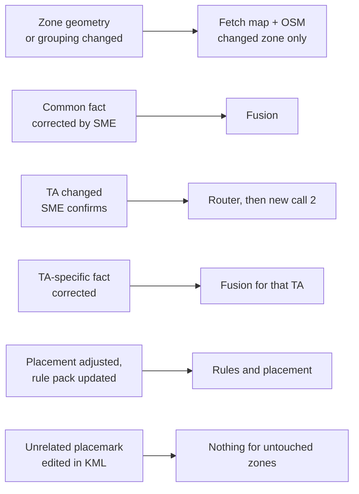

The boxes along the top are the stages. Each dashed box below is a kind of change, and its arrow points at the stage where the rerun starts.

**How reuse works.** Every run saves its expensive results (map image, OSM data, AI answers) together with a signature, a fingerprint of the exact inputs that produced them. On resume the system compares fingerprints. If they match, it reuses the saved result and makes no Azure or AI call. If not, it recomputes from the earliest affected stage \[S2\].

**The problem with the current key.** Today one input is the hash of the whole KML file \[S2\]. With many work points in one file, re-saving the KML after editing one placemark would change that hash and invalidate every zone, forcing paid re-runs of zones you never touched.

**The fix.** A zone's reuse key is built from its own geometry hash plus:

- the TA and the schema hash
- the rule-pack hash, registry hash and config hash
- the known facts and project inputs
- the image and context signature

The whole-file hash is still stored for audit but no longer decides reuse.

| What changed | Earliest stage that reruns | What is reused |
| --- | --- | --- |
| Zone geometry or grouping | Fetch map and OSM (for the changed zone only) | Other zones entirely |
| A common site fact corrected by the SME | Fusion | Imagery, map data, OSM, call 1 |
| The TA changed (SME confirms) | Router, then call 2 with the new schema | Imagery, fused common facts, map data |
| A TA-specific fact corrected | Fusion for that TA | Everything before call 2 |
| Placement adjusted, or rule pack updated | Rules and placement | Everything up to and including fusion |
| Unrelated placemark edited in the KML | Nothing for untouched zones | All of it |

If a new TA needs a larger analysis area than the saved image covers, the run stops with `ANALYSIS_EXTENT_INSUFFICIENT` and explains it before any new map purchase \[S1\].

**Imagery cache is future scope.** Reuse works within a run and when a run resumes from its parent \[S2\]. A cross-run cache of Azure Maps imagery and crops is future scope. Before it is built, three things need deciding: whether Azure terms allow storing the imagery, expiry (never, a set period, or when the imagery date changes) and scope (per project or shared).

**Example.** The SME changes Granite's TA after a conflict. The system fetches nothing new. It reruns the router, then runs one new call 2 with the new schema, then rules, placement and validation. The old version stays unchanged and a new immutable version is added beside it.

## 10. The rule pack: what it holds and how layers combine

The rule pack is a versioned, hashed set of data files (a composed pack) in which every value has a source and an authority level. The diagram shows the layers and the fields every rule carries.

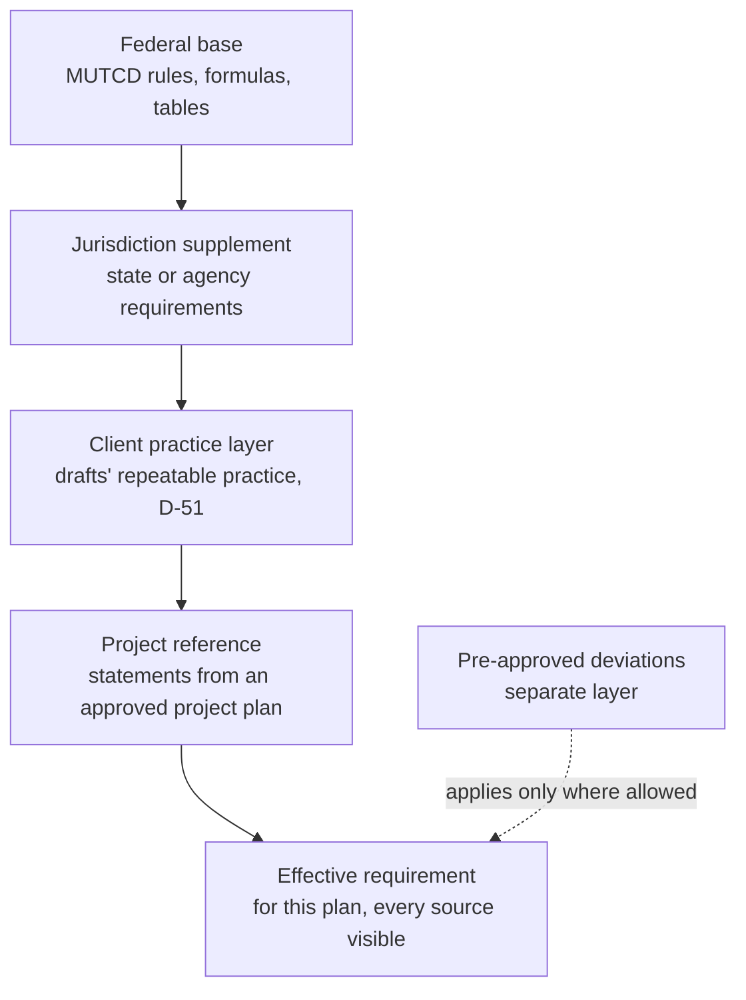

The stack on the left builds up from the federal base to the effective requirement. The panel on the right lists what the pack holds and what every rule must carry.

**Three authority layers, never mixed.** MUTCD rules sit in the federal base. State or agency requirements sit in the jurisdiction supplement. Statements taken from an existing project drawing sit in the project reference. A project statement is never promoted into the federal layer \[S1\]. Example: if the Granite drawing says 11 ft minimum lane width, that is stored as a project reference unless an authoritative source makes it the jurisdiction standard.

The effective requirement for a plan is the federal base, plus the applicable jurisdiction supplement, plus the applicable project requirements, with the source and authority of each value kept visible \[S1\]. Pre-approved deviations are a separate layer that can only apply where the rule they relax allows it.

**Notes that appear on every sheet.** All three reference drawings carry the same 12 general notes. Note 11 says the minimum lane width is 11 ft, measured from the edge of the drums or median barrier. Note 10 says the maximum spacing of devices in a taper equals the speed limit in mph (in feet). These are client drawing notes, so they go in the project-reference layer, not the federal layer. Whether note 10 also comes from the MUTCD is to be checked against Chapter 6, and how the 11 ft note combines with TA-6's 10 ft remaining-width limit is open (Section 15) \[S6\].

**Does the pack hold everything you listed?**

| Your item | In the pack? | Notes |
| --- | --- | --- |
| Rules | Yes | Shared MUTCD rules, TA-specific rules, jurisdiction supplements, project-reference constraints \[S1\] |
| Formulas | Yes | Taper length, channelizer spacing, buffer rules, A/B/C spacing \[S1\] |
| Tables | Yes | Tables 6B-1 to 6B-4 as structured data \[S1\] |
| Devices and signs | Partly | Work-zone signs are in the plan. A full device catalog (codes, sizes, drawing assets) is not, so it must be added |
| Typical Applications | Yes | Eligibility, figure, sign sequence and devices for TA-1, TA-6, TA-10 and TA-33 \[S3\]\[S6\] |
| Exceptions pre-feed | New | Pre-approved deviations with authority level, conditions and required justification |

**Three different things are called exceptions.** They must stay separate.

1. **Exceptions inside MUTCD itself**, such as the 9 ft lane-width option. These are rules in the federal layer.
2. **Pre-approved deviations**, such as an allowed sign shift. These are data in the pack with an authority level, conditions and justification text.
3. **One-off SME exceptions** for a single plan version. These are saved with the plan, never in the pack.

**Where pre-approved deviations come from.** From every available source, in this order of authority: MUTCD text, a jurisdiction manual, an approved project plan, an SME-approved setting. If no source provides a value, it stays empty and marked `SOURCE_REVIEW_REQUIRED`, and the SME is asked in real time. A proposed rule: a pre-approved entry may relax only items whose strength in the source allows it, and never a mandatory item. That needs confirming against the source text. Nothing in this document sets a number for it.

**Every rule carries:** `rule_id`, scope, authority level, strength, source document, section or page or note, jurisdiction, applicable TA, condition, action or value, units, version and effective date, and traceability \[S1\]. A value the source does not establish is never invented.

**Pack structure: composed and table-shaped (D-30, approved).** One shared base file plus one file per TA or layer, loaded together. The pack hash covers all parts. The files hold flat arrays of records, one array per future database table. Every record has a stable id and refers to others by id, never by nesting. Rules whose conditions vary a lot stay as validated JSON columns (JSONB in PostgreSQL).

| Table | Holds |
| --- | --- |
| `rule_pack` | version, hash, status, effective date |
| `source_document`, `source_ref` | document, edition, authority level, section, page |
| `ta`, `eligibility_condition` | TA id, title, figure, status, and its conditions |
| `rule` | scope, TA, authority layer, strength, jurisdiction, condition, action, units |
| `formula`, `table_def`, `table_row` | taper, spacing, buffer, Tables 6B-1 to 6B-4 |
| `device`, `ta_device_use` | the catalog and each TA's sign sequence |
| `deviation` | pre-approved band, conditions, justification, approver |
| `registry_field` | per-field thresholds and source type |

Effective rules become one view over `rule` and `deviation`, and every run stores the pack version it used. A `RulePackStore` interface, like `ArtifactStore`, keeps the engine from reading rule files directly. The first implementation reads JSON, a later one reads SQL. The MUTCD edition and the Chapter 6 source file are to be supplied by you, and no value is loaded until they are, because table numbers differ between editions.

**Device catalog (D-31).** Each entry holds an id, MUTCD code, name, category, sizes by road type and speed, legend and units, the TAs that use it, a source citation, a drawing asset reference and a version. Start with the devices used by TA-1, 6, 10 and 33. Fill each from these sources, in this order: the symbols already in your drawing template (extract them if the template is in the repo), then symbols from the MUTCD Chapter 6 file, then symbols found online for now. Your real library files come later. An entry whose symbol is not from your approved library carries `PLACEHOLDER_ASSET`, and any sheet using one shows a visible "placeholder symbols" label and is REVIEW\_REQUIRED. If two sources disagree, the entry is flagged for the approver. Anything a source does not state stays `SOURCE_REVIEW_REQUIRED`, which forces review (D-39). The catalog is versioned and hashed. Validators check each placed device exists, and the renderer stops only when no symbol exists at all. The devices seen on your three drawings are the starting list: W20-1, W20-4, W20-5R, W20-8, W21-5, W5-1, W4-2R, W9-2L, G20-2, R8-3, R9-9, R9-11L/R, R9-10L, R9-3BR, R2-11, RI 27.1.1, R3-7R and the M4-9 detour series, with the codes as printed \[S6\].

**Client practice layer (D-51, proposed).** Your drafts differ from the plain MUTCD figures in repeatable ways. To reproduce them, these become client-layer rules, each citing the draft it came from, and each needs your SME's confirmation:

| Client practice seen on the drafts | MUTCD position | Proposed client rule |
| --- | --- | --- |
| Advance signs 100 ft apart on urban streets | Table 6B-1 gives 100 ft for urban low speed | Same as MUTCD. No client rule needed |
| Longitudinal buffer 100 ft at 25 mph (Colorado) | Table 6B-2 gives 155 ft at 25 mph, but its use is an Option (Sect. 6B.06 para 11) | Client buffer 100 ft for urban 25 mph |
| Police detail and POLICE OFFICER AHEAD instead of flaggers and W20-7 (Colorado) | TA-10 shows flaggers | Not applied automatically. The draft uses flaggers; the SME switches to police after the draft (D-68) |
| No-parking signs (R8-3, TEMPORARY NO PARKING) along the work area | Not in the figures | Add-on module when parking exists |
| W20-1 and G20-2 on side streets inside the advance area | TA-33 note 2 requires devices on intersecting side roads | Side-street module |
| Sidewalk-closure signs (R9-9, R9-11) where the sidewalk is affected | Section 6G.10 | Pedestrian module |
| RI double-fines signs (R2-11, RI 27.1.1) | Section 6G.08 option | Rhode Island jurisdiction module |
| Device spacing in a taper equals the speed in mph (note 10) | Section 6K.01 para 04 says the same | Same as MUTCD |
| Minimum lane width 11 ft (note 11) | TA-6 note 1 says 10 ft | Client rule, open question |

**Versioning.** The pack is hashed. Changing any entry changes the hash, so affected runs recompute and the audit trail shows which pack version produced each plan. The POC pack is backed up and not used by the MVP. The new pack is authored from the MUTCD 11th Edition, Chapter 6, December 2023 revision, which you supplied (D-42). Each value cites its section. I have not read that file yet. Extraction happens in slice S4 (rule pack) \[S6\].

## 10A. Device catalog and symbol library (version 0.1)

The catalog and placeholder symbols are built and delivered with this plan as `tcp_symbol_library_v0.1.zip`: `device_catalog.json` (51 entries), one SVG per entry, and `gallery.html` to view them. Every symbol is marked `PLACEHOLDER_ASSET` and is replaced when your CAD blocks arrive (D-44, D-48).

**What each entry holds:** id, MUTCD code (when it is one), name, category, sizes in inches for conventional road, freeway and minimum, the source table and section, the TAs that use it, the drafts it was seen on, the asset file, a code status (MUTCD, CLIENT\_CODE, STATE\_CODE or DEVICE), notes and a version.

**Sources used.** Sign sizes come from the Chapter 6 file you supplied: Table 6H-1 (warning signs, p. 803 to 804), Table 6G-1 (regulatory signs, p. 796) and Table 6I-1 (detour signs). Device minimums come from Sections 6K.03 (cones), 6K.06 (drums), 6K.07 (barricades) and 6L.06 (arrow boards). Symbols are drawn from those descriptions and from your legend. They are simplified and are not copies of the Standard Highway Signs artwork.

**What it covers.** All signs on the four MUTCD figures and on your three drafts, the client legend items (cone, drum, Type 3 barricade, arrow board, message sign, flag tree, work vehicle, truck-mounted attenuator, flagger, police detail, work zone, trench, traffic-flow arrows, sign post, bus stop, parking meter), the STOP/SLOW paddle and a temporary barrier.

**Codes to confirm with your SME** \[S6\]:

| Printed on drafts | Issue | Catalog entry |
| --- | --- | --- |
| W20-8 POLICE OFFICER AHEAD | In the MUTCD 11th Ed., W20-8 is the SLOW face of the paddle | `CLIENT-POLICE-OFFICER-AHEAD`, size SOURCE\_REVIEW\_REQUIRED |
| M4-A8 | Not a MUTCD code; probably M4-8a END DETOUR | `M4-8a` |
| M4-9AL | Not in Table 6I-1 | `M4-9AL`, CLIENT\_CODE |
| R9-3BR USE CROSSWALK | Not in the Chapter 6 tables; probably R9-3bP from Part 2 | `R9-3BR`, CLIENT\_CODE |
| R9-10L | MUTCD code is R9-10 | `R9-10L` |
| RI 27.1.1 | Rhode Island sign; no RIDOT detail supplied | `RI-27.1.1`, STATE\_CODE |
| TEMPORARY NO PARKING with R8-3 | Plaque size not in Chapter 6 | `R8-3` with a note |

## 11. Citations and audit trail

Every object on a plan can be traced back to its rule, its source, its inputs, its calculation and the people who touched it. The diagram shows the chain, and the table shows where an auditor finds each answer.

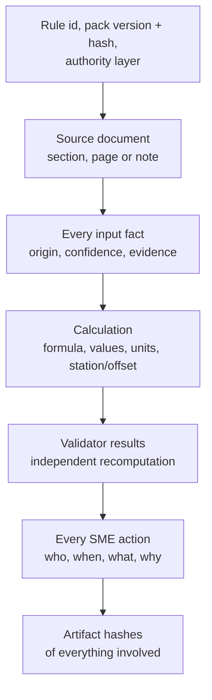

Read it top to bottom. Each box is one link in the chain, and the text beside it says what is recorded.

**What a trace record holds for each plan object (sign, taper, buffer, device)**

- the rule id, the rule-pack version and hash, and the authority layer
- the source document with section, page or note
- every input fact with its origin (KML, UI, map, AI evidence, SME), confidence and evidence reference
- the calculation: formula, input values, units, station and offset, orientation, dependencies
- the validator results, including the independent recomputation
- every SME action: who, when, what and why
- the hashes of the artifacts involved

**Where an auditor finds each answer**

| Auditor question | Where the answer lives |
| --- | --- |
| Why is this sign here? | The object's rule id, calculation and station and offset |
| Which rule version was used? | The rule-pack version and hash on the object and on the run |
| Where does this rule come from? | Source document, section and page on the rule |
| Did a person change anything? | The append-only decision ledger |
| What did the AI see? | AI request and response hashes, model version, prompt hash, image hashes, evidence references |
| Can this plan be reproduced? | Saved evidence plus the signature: a replay gives the same plan |
| Was an exception granted? | The exception record with its reason, the failed check and the SME |

**The decision ledger.** An append-only log, one entry per event: input received (with origin), grouping decided, TA proposed, TA confirmed, question asked, answer given, deviation applied, exception granted, version created, plan produced. Each entry stores actor, time, reason, the affected object and the before and after hashes. Entries are never edited or removed.

**Citations in this document.** Tags like \[S2\] point to the sources in Section 19. Statements from VS Code Claude's reading of the repo are marked as unverified until the prompt in Section 18 has re-checked them.

**Example.** An auditor asks about advance sign A on the Granite zone. The record shows: the rule id and pack version, the MUTCD table and section behind the distance, the speed and road type with their origin (for instance "posted speed, from project input"), the calculation with units, the station and offset on the road, the validator's independent recomputation, and the list of SME actions on the zone. Nothing on that sign is unexplained.

## 12. Data model and storage

The data model is built for many work points from day one. Cloud is out of the MVP (D-40), so storage stays local, behind thin interfaces (`ArtifactStore`, `StateStore`, `RulePackStore`) that are cheap to keep and would make a later cloud move an adapter swap.

**Data model**

| Entity | Key fields | Notes |
| --- | --- | --- |
| Project | project\_id, source files, default inputs, status, event log | One KML submission creates one project. Events are append-only |
| WorkLocation | location\_id, ordinal, source (file, input hash, placemark index, name), geometry (POINT, LINESTRING or POLYGON), geometry\_hash, include, role, attributes, reject\_reasons | Every parsed feature is stored, including unusable ones with reasons. Names are display-only |
| WorkZone | zone\_id, version, location\_ids, grouping (method, rule version, evidence), TA (hypothesis, source), sheet label, inputs, engine\_geometry\_hash, run\_ids, status | The unit of plan. Grouping method is KML\_EXPLICIT, AUTO\_RULE, USER or SME |
| Sheet | sheet\_id, number, label (Phase I, II...), scale, zone\_ids, template version | One drawn page. It holds one or more zones that fit together (Section 4A) |
| Run | The existing run, plus project\_id and zone\_id in its request | Run folders and stages unchanged |
| ProjectPlan | Zone entries, project status, cross-zone validation, hashes | An index over the per-zone plans |

**The engine input is free to change (D-23).** With no old TA-1 path, the zone, TA and sheet metadata can live in the engine input and the site-model hash, and nothing has to stay identical to the POC \[S5\]. For a multi-point zone the adapter builds a work path from the ordered points. How the engine measures signs from a path (from the upstream end, or from one reference point) is unverified and is the first check in Section 18.

**Project and zone statuses.** A zone uses the existing decisions: SUPPORTED\_AUTO, REVIEW\_REQUIRED, UNSUPPORTED\_POC, ERROR. A project adds:

| Status | Meaning |
| --- | --- |
| `ZONE_CAP_APPROVAL_REQUIRED` | The number of zones is over the max-zones setting |
| `RUNNING` | Zones in progress |
| `ALL_DRAFTED` | Every zone has a draft; cross-zone validation pending or passed |
| `PARTIAL` | Some zones drafted, some not. Per-zone drafts stay available; combined output waits |
| `REVIEW_REQUIRED` | A zone, grouping or cross-zone check needs an SME |
| `FAILED` | No zone produced a usable draft |

A project is SUPPORTED\_AUTO only if every zone is, the cross-zone check passes, and no grouping flag is open.

**Users and roles.** Permanent deviations need a named approver role (D-28). The state store therefore needs a simple user and role model: SME, approver and admin.

**Storage rules for the MVP (the cloud itself is deferred)**

1. All reads and writes go through `ArtifactStore` (blobs) and `StateStore` (index, events, heads). First implementations: local filesystem and SQLite.
2. Persisted data never holds a raw path. It holds an artifact reference `{uri, sha256, size, media_type}`.
3. Artifacts are write-once and content-addressed. A change creates a new artifact with a new hash.
4. Mutable state (SME heads, selection events, project status) uses versioned compare-and-set writes.
5. Every persisted JSON carries a schema version, with a migration function per version.
6. Stages are idempotent, so any worker can retry one.
7. Configuration comes from the environment, with no machine-specific values in artifacts.

**Cloud target (deferred, D-40).** Azure Blob Storage and PostgreSQL remain the likely fit, because the pipeline already uses Azure Maps and Foundry. Region, retention and tenancy questions are not asked for the MVP.

## 13. Build plan: slices and gates

The work ships in slices. Each slice has its own branch, and the next one starts only when the gate passes.

**Gate for every slice:** the existing suites that still apply are green, the new slice tests are green, and replay tests are deterministic. Unit and integration tests use recorded fixtures and fakes. Live Azure Maps and AI calls are used only in the final full-pipeline test (D-43). From slice S13 on, the golden comparator report must not get worse.

The slices are specified in full, with scope, contracts, acceptance criteria, tests and a prompt seed for Claude Code, in the separate file `TCP_MVP_Development_Slices.md`. Summary:

| Slice | Scope | Depends on |
| --- | --- | --- |
| S0a | Done: production layout (`src/tcp_planner/`, `apps/web/`, `config/`, `rule_pack/`, `assets/`, `var/`, `backup/orphans/`), behavior unchanged, report in `docs/reports/S0a_restructure_report.md` | none |
| S0 | Repo verification report (Section 18), fixture harness, schema spike, the two S0a follow-ups (protected-run test, Foundry default) | S0a |
| S1 | Domain model and KML intake for all geometry types (coordinates only; custom KML keys are future scope) | S0 |
| S2 | Storage interfaces with local adapters, artifact references, project store | S0 |
| S3 | Project orchestrator, one child run per zone, engine input extended, location list in the UI | S1, S2 |
| S4 | Rule pack v1: composed, table-shaped, `RulePackStore`, TA-1, 6, 10 and 33 from Chapter 6, tables 6B-1 to 6B-4, client layer | S0 |
| S5 | Device catalog and symbol library integration | S4 |
| S6 | Site understanding: call 1 deciding fields, geometry fusion at low confidence, width uncertainty, hybrid crops | S3 |
| S7 | Router and call 2 TA fields | S4, S6 |
| S8 | Layout engine per TA with add-on modules, and validators | S4, S5, S7 |
| S9 | Grouping engine (case table) and zone split | S3, S8 |
| S10 | Obstruction check, fallback ladder, exceptions, deviations, approver role | S8 |
| S11 | Question form, SME review, TA change, regroup, reuse keys, exception reuse | S9, S10 |
| S12 | Sheet packing, sheet template and PDF sheet set | S8, S9 |
| S13 | Golden comparator and the live full-pipeline test | S12 |
| S14 | Polygon and line geometry normalization | S9 |
| S15 | Orphan sweep: find unused files and code, move them to `backup/` with a manifest. Runs twice: after S3 and after S14 | S0, S3 (first run); S14 (final run) |

S4 and S5 can run beside S1 to S3. S15 runs once after S3 and again after S14. Shared map acquisition and the cloud are not in the MVP.

**What is unknown until measured.** Per-run cost averages (needed before any cost caps), the deployed model's image-size limit, width measurement accuracy, and whether the engine tolerates paths over 150 m.

## 14. Tests and risks

### Tests

Tests run after every slice. Unit and integration tests use recorded fixtures and fakes and make no live calls. Live Azure Maps and AI calls are allowed only in the final full-pipeline test.

- **Replay fixtures:** a recorded run replays with zero calls and gives the same site model, eligibility result, plan, validation results and request fingerprint.
- **Parsing:** one Point; Granite (5 Points); E Second Street (2 Points); Colorado (1 Point); Point plus line in one Placemark; separate Placemarks; lone line; polygon with and without holes; MultiGeometry; nested Folders; duplicate coordinates; a line over the length limit.
- **KML content:** only coordinates are read; `ExtendedData` keys, including `tcp:` and `selected_ta`, are ignored; placemark names appear only as display labels.
- **Mandatory fields:** the Run button stays disabled until all mandatory start fields are filled; no code fills them; a computed check that contradicts one raises a conflict, never a change.
- **Grouping:** same result regardless of placemark order; different roads never merge; an SME grouping entered in the UI overrides the rule; an over-length zone, and a user-drawn line over 150 m, are split and flagged; points needing different TAs never share a zone.
- **Router:** one match, several matches, no match, user-versus-facts conflict, unknown deciding fact, low confidence, no match naming only pack TAs, near match giving "did you mean". The expected TA for each real KML is treated as a hypothesis, never a label.
- **Crops, widths and sheets:** code crop first, a fetch only when pixels are insufficient, every image resized to the model limit, a width interval across a threshold becomes UNKNOWN, a zone that does not fit at 1" = 40' tries 1" = 50', overlapping zones never share a sheet.
- **Conflicts:** the automatic search never moves taper or buffer, a manual SME move is recorded as a one-off exception, obstruction on a sign spot, sourced band, no band, low-confidence obstruction, work-fact change, re-run limit of one.
- **Flow:** a single point as a one-zone project; a multi-zone run; max-zones cap holds before any API call; partial failure keeps per-zone drafts.
- **Replay:** resume reuses map, OSM and AI evidence with zero calls; an unrelated placemark edit leaves other zones reusable; a TA change resumes at the router.
- **SME:** immutable per-zone revisions; regroup creates a new zone version; the form shows sub-questions; cross-zone findings are read-only.
- **Audit:** every plan object has rule, source, inputs and calculation; the ledger is append-only.
- **Storage:** both adapters pass one shared contract suite; no raw path in persisted JSON; hash-verified migration.
- **Real KMLs (the only tests that call Azure Maps and the AI live):** Granite, E Second Street and Colorado through the whole flow, compared with the reference drawings (expected TA-33, TA-6 and TA-10) in a discrepancy report. A correct report is a pass, whether or not a plan is produced.

### Golden set from your drafts

Delivered with this plan as `tcp_golden_set_v0.1.zip`: one JSON file per job (`golden_colorado.json`, `golden_e_second.json`, `golden_granite.json`), the extraction scripts and a README \[S6\]. Version 0.1 is extracted automatically from the text layer of your PDFs and must be checked by your SME.

**What each golden records, per sheet:** phase label, sheet number, scale, the work points shown, every sign at its post (code and position in feet from the work point), the advance-sign sequence and spacing on each approach, side-street signs, device counts, callout codes, the arrow board, every dimension label with its position, and the job notes.

**How positions were measured.** Each sign's small code label sits next to its post. Its centre is measured from the work-point label and converted with the sheet scale (the sheets are 34 x 22 in at 1 in = 40 ft or 50 ft). Expected error is about 5 to 15 ft. Taper, buffer and channelizer geometry are drawn as shapes, not text, so they are not captured yet. Their dimension labels are.

**What the extraction already shows**

- Colorado: W20-1, W20-4 and the police sign on both approaches, measured 99.8 to 100.6 ft apart, matching the 100 ft labels. The automatic draft will show W20-7 Flagger in that position; the comparator treats it as the expected pre-switch difference (D-68).
- E Second St: W20-1, W21-5 and W5-1 are drawn about 40 ft apart but labelled 100 ft MIN. Your drafts are schematic for advance signs, so the comparator must use the labelled value where one exists.
- Granite: W20-1, W20-5R and W4-2R about 100 ft apart on sheets I, IV and VI. Sheets near intersections need hand checking, because the automatic approach split mixes in side-street signs.

**Comparison rules.** Exact: TA, sheet count, work points per sheet, scale, the order of advance signs per approach, and the set of sign codes. Within tolerance: sign position along the road (15 ft) and spacing (10 ft), using the labelled value when the drawing is schematic. The sign must be on the same side of the road.

### Will the output match your drafts exactly?

No, and it shouldn't be expected to be byte- or pixel-identical. With the plan as written, the structure should match: TA, signs, order, counts, sheets and dimension values. Positions should match within tolerance. Four things stop an exact match unless we act:

1. **Client practice differs from the MUTCD.** The 100 ft buffer at 25 mph, police instead of flaggers (applied by the SME after the draft, so Colorado compares after that switch), no-parking signs, side-street signs and RI double-fines signs are not in the figures. The client layer in Section 10 encodes them. Without it, the system would draw a 155 ft buffer, flaggers and no extras.
2. **Your drafts are partly schematic.** Advance signs are sometimes drawn closer than labelled. The system draws to scale, so drawn positions will differ while the labels agree.
3. **Field judgment.** Note 9 on every sheet says distances may be adjusted in the field. Sign spots chosen to avoid driveways, trees or intersections will differ.
4. **Base imagery and drawing style.** Your sheets use a different aerial image and your CAD symbols. Ours use Azure Maps and placeholder symbols until your library arrives.

The comparator (slice S13) reports each difference with its cause, so every mismatch is either fixed in the rules or accepted as field judgment.

### Risks and complexity

| ID | Risk | Complexity | Mitigation |
| --- | --- | --- | --- |
| R1 | The engine may measure signs from one reference point and not from the upstream end of a path \[S2\] | High | Verify first (Section 18). The adapter supplies the right station if needed |
| R2 | The grouping rule is not backed by an authority source and could merge or split wrongly | High | Compute from rule-pack distances, flag until confirmed against the reference plans, SME regroup control |
| R3 | A merged zone can exceed the 150 m engine limit | Medium | Automatic split with a flag (D-19); overlap at the seam is reviewed |
| R4 | Grouping needs road type and speed, known only after site understanding | Medium | Group on a conservative extent first, then run a post-fusion consistency check |
| R5 | The router wrongly picks a TA from weak facts | High | Confidence thresholds per field, a required out-of-scope answer, all conflicts shown to the SME |
| R6 | The new obstruction check is untested on real sites \[S4\] | Medium | Tested on the three reference jobs; low confidence goes to the SME |
| R7 | False obstruction detections move signs for nothing | Medium | Low confidence goes to the SME and is never auto-acted on |
| R8 | Sourced deviation bands do not exist in the text for some devices | Medium | Leave empty with `SOURCE_REVIEW_REQUIRED` and ask the SME in real time |
| R9 | Question-form fatigue if too many questions appear | Medium | Ask only blocking questions, batch them, skip with a safe default |
| R10 | Larger image extent for long zones | Medium | Per-zone extent check; mosaic support exists, limits to verify |
| R11 | Polygon geometry touches fusion, validators and the SME image | High | Late slice with a normalization layer |
| R12 | The merge gap and the sheet-packing rule are guesses from three drawings | Medium | Settings flagged until your SME confirms; the SME can regroup |
| R13 | N zones multiply cost and may hit rate limits | Medium | Max-zones cap, one zone at a time at first. Cost caps wait for measured data |
| R14 | Recorded model responses are needed for stable replay hashes | Low | Record fixtures in S0 |
| R15 | Shared acquisition may not match a direct centered fetch | Medium | Not in the MVP; measure first if revisited |
| R16 | Placeholder symbols reach a drawing as if approved | Medium | `PLACEHOLDER_ASSET` label on the sheet and REVIEW\_REQUIRED |
| R17 | Width error is larger than the margin at a TA-6 threshold | High | Store uncertainty and ask the SME when a limit falls inside it (proposal D-38) |
| R18 | The model downsizes images, so small features vanish | Medium | Resize in code, crop for detail, hybrid fetch |
| R19 | The Granite KML and the Granite drawing are different jobs (WPI 3159540 and 3178233) | Medium | Get the matching drawing, or confirm they are neighbouring jobs |
| R20 | Fused road geometry is often inaccurate | Medium | Low confidence; imagery decides; disagreements recorded |
| R21 | Nobody holds the approver role at the client | Medium | Ask the client; role model in the state store |

## 15. Decision log

Approved means you said yes in this conversation \[S5\]. Proposed means it is in this plan but still needs your approval. Open means no decision yet. Updated October 28, 2026.

| ID | Decision | Status | Section |
| --- | --- | --- | --- |
| D-01 | No select-one gate: every work point is processed | Approved | 3 |
| D-02 | Work zones with automatic grouping; ask the SME when the system cannot decide | Approved | 4 |
| D-03 | Hierarchy: project, work points, zones (one TA each, optional phase). KML inputs used when supplied, TA also enterable per zone at run time | Approved | 4, 12 |
| D-04 | One run per zone with an orchestrator; shared acquisition only if measured | Approved | 12, 13 |
| D-05 | Full work-location record now | Approved | 12 |
| D-06 | Polygon and line support, built in a late slice | Approved | 13 |
| D-07 | Thin storage interfaces with local adapters only. The cloud is deferred (D-40) | Approved | 12 |
| D-08 | Target: Azure Blob Storage and PostgreSQL | Deferred (D-40) | 12 |
| D-09 | Zone-level reuse keys instead of the whole-file hash | Approved | 9 |
| D-10 | One SME review per zone, regroup controls, project-scoped history with an "inherit" action | Approved | 8 |
| D-11 | Code picks the TA; AI only observes | Approved | 6 |
| D-12 | TA-specific fields folded into call 2 | Approved | 5 |
| D-13 | Obstruction check for all TAs from the start | Approved | 7 |
| D-14 | Pre-approved deviations as sourced data in the pack; from every available source; the SME is asked in real time when none exists | Approved | 7, 10 |
| D-15 | "Compliant with field adjustment" only when the band has an authority source | Approved | 7 |
| D-16 | TA change: the system proposes and the SME confirms; a clash with the TA you chose is shown | Approved | 6, 8 |
| D-17 | Low-confidence obstructions go to the SME; checks re-run after any adjustment | Approved | 7 |
| D-18 | One question form with conditional sub-questions | Approved | 8 |
| D-19 | A zone longer than 150 m is split automatically at the largest gaps, each piece flagged `ZONE_SPLIT_AUTOMATIC`. User-drawn lines and zones over 150 m are split the same way | Approved | 4 |
| D-20 | Engineer-designed plans offered later; the design is stored here | Approved (deferred) | 16 |
| D-21 | Full citation and audit trail for every value | Approved | 11 |
| D-22 | KML `tcp:` keys and legacy `selected_ta` | Future scope (D-66) | 4 |
| D-23 | The engine input may change freely, because there is no legacy path | Approved | 12 |
| D-24 | Adjustment bands. A sign may move to a nearby available space. Taper and buffer are never in the pre-approved list. The SME may still move them by hand as a one-off exception (my reading, to confirm). Band values come from sources. Who holds the approver role is not set | Partly decided | 7, 10 |
| D-25 | Cost estimates and caps, the reference-only toggle and cross-run cache are future scope. Only a max-zones cap in config now. Work happens on branch `tcp-mvp/base` | Approved | 4, 13 |
| D-26 | Grouping and sheet packing: case table, per-TA settings, ordering, two-TA sheets | **Open** (proposal in 4A, D-49) | 4A |
| D-27 | Hybrid crops: crop in code first, fetch higher zoom only when pixels are insufficient. Images resized in code to the model limit | Approved | 5 |
| D-28 | A permanent deviation is proposed by the SME and approved by a named approver role | Approved | 7, 12 |
| D-29 | Reuse of an identical exception: one-click reuse, only on an exact match, logged as a new approval | Approved (option B) | 7 |
| D-30 | Composed, table-shaped rule pack with a `RulePackStore` interface | Approved | 10 |
| D-31 | Device catalog from your library plus AI extraction from the MUTCD; disagreements go to the approver | Approved | 10 |
| D-32 | No separate old TA-1 path. One pipeline for every TA. This replaces the earlier plan to migrate TA-1 later (D-41) | Approved | 13 |
| D-33 | Router starting values (0.85 auto-select, 0.80 safety-critical, near match at most one failed condition) | Approved (delegated to Claude) | 6 |
| D-34 | Speed source order: project input, posted speed evidence, OSM `maxspeed` | Superseded by D-59: speed is a mandatory SME field; the order is a future automation candidate | 6 |
| D-35 | The router reasons only about TAs in the pack, says "no TA in the pack fits", and asks "did you mean" for near matches | Approved | 6 |
| D-36 | Future scope: pipeline chatbot, free-text description parsing, cost estimates and caps, reference-only toggle, cross-run cache | Approved | 16 |
| D-37 | Geometry from several sources is fused and treated as low confidence; imagery plus the best fusion result decides the truth | Approved (SME input) | 5 |
| D-38 | Road width stored with an uncertainty; a threshold inside the interval becomes UNKNOWN and asks the SME | Approved | 5 |
| D-39 | A plan that uses a `SOURCE_REVIEW_REQUIRED` rule is forced to REVIEW\_REQUIRED, with the item in the audit trail | Approved (option A) | 10 |
| D-40 | The cloud move is out of the MVP. Storage is local | Approved | 12, 16 |
| D-41 | The POC is backed up. The MVP is built on branch `tcp-mvp/base` with one pipeline for all TAs, and no TA-1 goldens | Approved | 1, 13 |
| D-42 | Rule source: MUTCD 11th Edition, Chapter 6, December 2023 revision. References: E Second St for TA-6, Colorado St for TA-10, Granite St for TA-33 | Approved | 10, 4A |
| D-43 | Live Azure Maps and AI calls only in the final full-pipeline test, not in unit or integration tests | Approved | 13, 14 |
| D-44 | Device symbols: your template first, then the MUTCD, then online, marked `PLACEHOLDER_ASSET` until your real library arrives | Approved | 10 |
| D-45 | A phase is a drawn sheet, not a time step. Sheet packing as in Section 4A | Proposed | 4A |
| D-46 | The Azure Maps terms check is dropped | Approved | 16 |
| D-47 | TA-1 is in the MVP as an ordinary TA, built from MUTCD Figure 6P-1 | Approved | 1, 6 |
| D-48 | Symbol library v0.1 (51 placeholder symbols, catalog from Chapter 6 tables) | Approved, symbols to be replaced later | 10A |
| D-49 | Grouping uses the case table and per-TA settings, not a single distance, in two passes | Proposed | 4A |
| D-50 | Golden set from your drafts, with a comparator and a live full-pipeline test | Proposed | 14 |
| D-51 | Client practice layer from your drafts (100 ft buffer, add-on modules). The police variant is not automatic (D-68) | Proposed | 10 |
| D-52 | Orphaned files and code are moved to `backup/` with a manifest, never deleted. You approve the list before anything moves | Approved | 13 |
| D-53 | Geometry fusion sources, open-source/public only: OSM, MassGIS, RIGIS, USGS, plus city open data as needed. No commercial API in fusion | Proposed | 5 |
| D-54 | Input schema: a general schema for every TA plus a per-TA schema, each field's source and MUTCD citation listed | Proposed | 4B |
| D-55 | `duration`, `night_work` and the other fields you listed are kept as asked-if-needed UI answers (reverses the earlier drop), because MUTCD options depend on them | Approved | 4B |
| D-56 | Vehicle presence, shadow vehicle and TMA are computed, not asked. The 45 mph TMA threshold is a proposed client policy, not a MUTCD rule | Proposed | 4C |
| D-57 | Lane width and encroachment are computed each time placement changes, with escalation to a lane closure proposed automatically and confirmed by the SME | Approved | 4C |
| D-58 | Road type and speed prior from OSM and state tags | Future scope | 4C |
| D-59 | Mandatory start fields, typed in the UI before Run: `road_type`, `posted_speed_mph`, `traffic_volume`, `lane_closure`. No code calculates them and no other source fills them in the MVP. A contradicting computed check raises a conflict, never a change | Approved | 4B |
| D-60 | Routing decision tree and explicit eligibility: TA-6 needs a shoulder and a low-speed minor road; TA-33 is one OR'd rule; only TA-1, 6, 10 and 33 exist | Approved | 6 |
| D-61 | AI output as a flat facts list in JSON (no TOON). Decided after the S0 spike: the current per-property schema is rejected by Foundry (HTTP 400, union-type limit), the facts list is accepted | Approved | 5 |
| D-62 | Azure Maps is allowed alongside open data | Approved | 5 |
| D-63 | Added sources: HPMS, Census urban areas, USGS 3DEP, MBTA/RIPTA GTFS, FRA crossings, with the full OSM tag list | Approved | 5 |
| D-64 | The AI returns positions; code computes every length | Approved | 4B |
| D-65 | SME approval gate config, default on | Approved | 7 |
| D-66 | The KML supplies coordinates only. Custom KML keys and `selected_ta` are future scope | Approved | 4 |
| D-68 | `traffic_control_method` is not a UI start field. Code sets Flagger when TA-10 is chosen; police details are a post-draft SME review action | Approved | 4B, 8 |
| D-69 | `work_side`: the AI suggests, the SME confirms on the form | Approved | 4B |
| D-70 | Grade-crossing notification dropped from the MVP; crossing presence still detected and flagged | Approved | 4B |
| D-71 | Title-block location uses the road name the POC already prints; the SME does not type an address | Approved | 4A |
| D-72 | Placemark names used as display labels on the sheet | Approved | 4 |
| D-73 | "Select TA" dropdown in the UI (Auto, TA-1, TA-6, TA-10, TA-33), per project and per point | Approved | 4B |
| D-74 | Slice S0a done: production layout, one package `src/tcp_planner`, UI in `apps/web`, data in `config/`, `rule_pack/`, `assets/`, run data in `var/`, 16 files in `backup/orphans/2026-10-28/` with a manifest and restore script. Behavior unchanged (all suites, 13 offline scenarios and 36 saved-run replays identical) | Done | 13 |
| D-75 | Branches: base `tcp-mvp/base`, one branch per slice `tcp-mvp/sNN-short-name` (the `TCP-MVP` name collides with `tcp-mvp/` on Windows) | Approved | 13 |
| D-76 | Editable install required once per environment: `pip install -e . --no-build-isolation` | Approved | 13 |
| D-77 | `runs/` moved to `var/runs/`; old POC runs stay tracked but cannot be resumed, because they store absolute paths. Store run paths relative to the runs folder in S2 | Approved | 12 |
| D-78 | Default AI provider becomes Foundry in S0 (the code used to fall back to the direct Anthropic provider when `TCP_AI_PROVIDER` is unset); with no Foundry configuration the error says so. The direct provider module moves to backup in S15 | Approved | 5 |
| D-79 | The pre-existing failing protected-run test is fixed in S0 to check that the run folder is tracked and unchanged, which is its real intent | Approved | 14 |
| D-80 | Spike findings are requirements for S6 and S7: (1) `lanes_per_direction` is unstable (Granite 2/1/1) and safety-critical: cross-check with OSM lanes and state data, a disagreement makes it UNKNOWN and raises an SME question, and call 2 re-asks it with a lane-marking crop. (2) Marks are weak (`lane_line`, `shoulder_edge`, `curb`): the deterministic `cross_section.py` is the primary width source and AI marks are secondary; an invalid or missing mark makes the width UNKNOWN; marks are requested again from call 2 crops. (3) `sidewalk_present` and `sidewalk_side` are often UNKNOWN on the wide image: resolve them in call 2 with a crop plus OSM sidewalk tags. (4) Call 1 output is about 2,300 tokens (about 700 of them thinking): cap each evidence string at 15 words and use a short fixed reason for UNKNOWN (see `docs/reports/S0_prompt_tuning_proposal.md`) | Approved | 5, 6 |
| D-81 | Rule pack v1 (S4) covers TA-1, TA-6, TA-10 and TA-33 and replaces the POC pack. Until then `rule_pack/` holds only `APPROVED_TWO_LANE_POC_RULE_PACK.json` | Approved | 10 |
| D-67 | New fields added to the schema: work side, work type, work length, lane width, direction of travel, bike lane, accessible route, detours, work-zone speed, add-on triggers, title-block fields, median work, and the TA-10 and TA-33 fields | Approved | 4B |

### Open questions (version 9)

Slices S0 to S5 can start now. Each item has a default so no slice is blocked.

| # | Question | Needed by | Default if unanswered |
| --- | --- | --- | --- |
| 1 | ~~Foundry error text and the S0 schema spike results~~ Closed: spike done, facts list chosen (D-61, D-80) | S6 | Done |
| 2 | Default `work_space_length_ft` per `work_type` for single points | S8 | Asked per point on the form |
| 3 | Does the title block need city, state and ZIP as well as the road name the POC prints? | S12 | Road name only, as the POC does today |
| 4 | My reading of "taper instead of police": the draft uses the standard TA-10 flagger layout with its tapers, and the SME switches to police after the draft | S7 | As written (D-68) |
| 5 | The TA-6 low-speed cutoff (note 2 gives no number) | S4 | `SOURCE_REVIEW_REQUIRED`, forces review |
| 6 | TMA suggestion threshold (45 mph proposed) or none | S8 | No automatic suggestion |
| 7 | Default work-vehicle width and its source | S8 | `UNKNOWN`, asked on the form |
| 8 | SME check of the golden set v0.1 | S13 | Used as v0.1 with tolerances |
| 9 | A TA-1 reference draft | S13 | Compared with Figure 6P-1 only |
| 10 | The Granite drawing matching the KML (WPI 3159540) | S13 | Used for sheet rules only |
| 11 | Confirm the client practice layer (100 ft buffer, add-on modules) | S8 | Built as proposed, flagged |
| 12 | Confirm grouping settings and the case table | S9 | Start values, flagged |
| 13 | Sign codes to confirm (W20-8 police, M4-A8, M4-9AL, R9-3BR, R9-10L, RI 27.1.1) | S5 | Catalog as listed |
| 14 | The 11 ft lane-width note against TA-6's 10 ft | S8 | Both checked; the stricter gives a warning |
| 15 | Who holds the approver role | S10 | Configured list of approver users |
| 16 | Taper and buffer: my reading of your clarification | S10 | As written in Section 7 |
| 17 | Which RIDOT and MassDOT documents apply | Later | MUTCD plus client layer |
| 18 | SME confirmation that the Section 4B schema misses nothing | S6 | Built as written |
| 19 | Push and merge S0a: push `tcp-mvp/s00a-restructure`, review it, merge into `tcp-mvp/base` | Before S0 | Push now, merge after review |
| 20 | ~~Approve D-78 and D-79~~ Closed: approved and done in S0 | S0 | Done |

**Closed this round:** traffic control method not a start field, flaggers by default, police after the draft (D-68); lengths by code (D-64); JSON only, no TOON (D-61); work side suggested by AI and confirmed (D-69); grade-crossing notification dropped (D-70); title block uses the POC road name (D-71); placemark names as labels (D-72); Select TA dropdown (D-73).

## 16. Deferred: engineer-designed plans

This feature is not built now. You approved offering it later and asked for the design to be kept here (decision D-20).

**What it is.** Some jobs fit no TA. Today your SME designs a custom plan in AutoCAD for those. An engineer-designed plan is the tool's version of that. The SME places signs and devices by hand on the site image, and the system still checks them against the shared rules (taper formula, spacing table, channelizer spacing, buffer rules). The status is `ENGINEER_DESIGNED`.

**How it would work**

1. The router returns `NO_TA_MATCH` with the failed conditions. The SME chooses "design this plan myself" on the form.
2. The system keeps the site model, imagery and conflicts, and opens a structured placement mode. The SME adds each device with a type, station and offset. AI is used only to read natural-language instructions.
3. Validators run the shared rules and report each result per device. Rules that belong to a specific TA do not apply.
4. The plan carries a visible banner: "Not a MUTCD typical application. Layout set by the SME." The audit trail names the SME as the designer of each device.
5. Any rule failure that remains must be accepted as a recorded exception with a reason, as in Section 7.

**Before it can be built**

- The client agrees that tool-assisted custom plans are acceptable, and who is accountable for them. This is unknown today.
- The shared rules (taper, spacing, channelizer, buffer) are complete in the rule pack, each with a source.
- A structured placement mode exists in the SME review screen.
- Drawing assets exist for the devices the SME may place. Approved assets are not available for the new TAs today, so rendering fails closed with `DWT_ASSET_NOT_AVAILABLE_FOR_SELECTED_TA` \[S1\].

**Open questions for later**

- Does the client want an engineer sign-off step recorded in the audit trail?
- Should an engineer-designed plan ever be eligible for SUPPORTED\_AUTO? The proposed answer is no, it always needs review.

### Other items deferred by your decision (D-36)

| Item | Design note for later |
| --- | --- |
| Pipeline Q&A chatbot | Answers only from tool results, so every answer cites a real record and "I don't know" is allowed. Question types: why, where from, status, history, cost, checks. Tools such as `get_object_trace`, `get_rule`, `get_open_questions`, `get_ledger`, `get_validation_results`. Open: read-only or able to act. Actions would go through the same deterministic controls with confirmation. Needs an inventory of the assistant tools that exist today |
| Free-text description parsing | AI converts the description into schema fields, each stored with the quoted phrase as evidence and labelled "SME text, AI-parsed". Unstated values stay UNKNOWN, and a structured field beats parsed text. Open: parse inside call 1, or a cheap text-only call first so the SME can correct it before imagery is bought |
| Cost estimates and caps | Needs measured per-run usage first. Only a max-zones setting exists now |
| Reference-only toggle | The role field is stored. A UI toggle to mark stray points such as a distant yard comes later. Every point is work by default |
| Cross-run imagery cache | Store Azure Maps imagery and crops and reuse them for the same location. Needs an expiry rule and a scope (per project or shared). The Azure terms check was dropped by your decision |
| Cloud move | Azure Blob and PostgreSQL adapters, a migration tool, and the client's region, retention and tenancy answers. Out of the MVP (D-40) |

## 17. Architecture Decision Records

Each record states status, context, decision, consequences and what was rejected. "Accepted" means you approved it; "Proposed" needs your approval; "Open" has no decision yet. They map to the decision log in Section 15.

### ADR-001: One project model; a single point is a one-zone project

**Status:** Accepted. **Context:** Single-point and multi-point jobs would otherwise need two code paths. **Decision:** Every submission is a Project with work locations and work zones. A single point is one location in one zone. **Consequences:** One flow to test. A thin wrapper keeps single-point output identical. **Rejected:** A separate multi-point path (duplicate logic, drift).

### ADR-002: The work zone is the unit of plan; automatic grouping; no selection gate

**Status:** Accepted. **Context:** An SME draws one TCP per work zone and handles the whole job. **Decision:** Process every point. Group by user input, then the automatic rule. Ask the SME when the system cannot decide. **Consequences:** Grouping quality is a core risk and stays flagged until confirmed (D-26). **Rejected:** Select-one-then-run; one plan per point (overlapping layouts).

### ADR-003: The engine input may change freely

**Status:** Accepted. **Context:** The POC engine input is part of the site-model hash \[S2\], but the POC is backed up and there is no legacy path (D-41). **Decision:** Zone, TA and sheet metadata can live in the engine input. **Consequences:** No equivalence tests or TA-1 goldens. Replay fixtures from the new pipeline are the regression check. **Rejected:** A frozen input with a separate wrapper.

### ADR-004: KML supplies coordinates only

**Status:** Accepted (D-66); replaces the earlier KML input contract. **Context:** You moved custom KML tags to future scope. **Decision:** Only geometry is read. `tcp:` keys and the legacy `selected_ta` are ignored. Placemark names are display labels only. TA hypothesis, grouping and sheet labels come from the UI. **Consequences:** A simpler intake; the KML keys can return later without changing the model. **Rejected:** Honoring KML keys in the MVP.

### ADR-005: One run per zone with an idempotent orchestrator

**Status:** Accepted. **Context:** The run, resume, evidence and SME machinery is per run \[S2\]. **Decision:** Each zone is a child run. A project orchestrator schedules zones, tracks status and can be retried safely. **Consequences:** Existing machinery is reused. Sharing evidence across zones needs a later mechanism. **Rejected:** One run with nested sub-pipelines (rewrites run, stage, resume and evidence code).

### ADR-006: Thin storage interfaces; cloud deferred

**Status:** Accepted. **Context:** The cloud move is out of the MVP (D-40). **Decision:** Keep `ArtifactStore`, `StateStore` and `RulePackStore` as thin interfaces with local adapters only. **Consequences:** A later cloud move is an adapter swap. No cloud adapters, migration tool or client-limit questions now. **Rejected:** Building cloud adapters now.

### ADR-007: Immutable, content-addressed artifacts and artifact references

**Status:** Proposed. **Context:** Audit and replay need artifacts that never change. **Decision:** Artifacts are write-once and referenced by `{uri, sha256, size, media_type}`. No raw paths in persisted data. **Consequences:** Cheap verification, and migration can verify hashes. **Rejected:** Mutable files addressed by path.

### ADR-008: Zone-level reuse keys

**Status:** Accepted. **Context:** The whole-file KML hash invalidates every zone when one placemark changes. **Decision:** Reuse keys use the zone geometry hash plus TA, schema, rule-pack, registry and config hashes, known facts, inputs and image context. **Consequences:** Precise invalidation and lower cost. Two rules to test. **Rejected:** Keeping the file hash (wasted paid calls).

### ADR-009: SME review per zone, regroup, project-scoped history

**Status:** Accepted. **Context:** The SME reviews one drawing, and geometry-only history is shared across projects. **Decision:** One conversation per zone. Regroup, merge and split are deterministic operations that create new zone versions under a stable zone\_id. New history is project-scoped, with an explicit inherit action. **Consequences:** Safe in a shared cloud system. Corrections are not carried over implicitly. **Rejected:** One project-wide conversation; geometry-only history.

### ADR-010: Deterministic cross-zone validation; no automatic regulatory merging

**Status:** Proposed. **Context:** Interactions between zones need checks, but merging needs authority. **Decision:** A deterministic project validator flags overlaps and conflicts and never merges. Grouping uses a non-regulatory rule flagged for review until confirmed. **Consequences:** Conservative; some jobs go to review. **Rejected:** Silent automatic merging.

### ADR-011: Geometry normalization; Polygon and line support

**Status:** Accepted. **Context:** Work areas arrive as points, paths and polygons. **Decision:** Add a normalization layer (validate, orient, project, reject with reasons) and map each geometry type to an engine input. Built in a late slice; the data model supports all types now. **Consequences:** A large change confined to one slice. **Rejected:** Centroid-only polygons (can fall outside a concave shape); choosing a path's start or midpoint arbitrarily.

### ADR-012: Project status vocabulary and partial results

**Status:** Proposed. **Context:** One of N zones may fail. **Decision:** Statuses as in Section 12. Per-zone drafts stay available; combined output waits. SUPPORTED\_AUTO only when every zone passes, cross-zone checks pass and no grouping flag is open. **Consequences:** Clear states and useful partial work. **Rejected:** All-or-nothing; one worst-of status.

### ADR-013: Zone cap only; cost guardrails deferred

**Status:** Accepted. **Context:** N zones multiply paid calls, but there is not enough usage data for cost caps. **Decision:** One configurable max-zones setting. Above it, the run waits for one-click approval. Cost estimates and cost caps are future scope. **Consequences:** Some cost risk until measured. **Rejected:** Guessing cap values; no limit at all.

### ADR-014: Shared acquisition deferred until measured

**Status:** Proposed. **Context:** Nearby zones could share one map and OSM fetch, but re-cropped pixels may differ from a direct centered fetch. **Decision:** Do not build it until pixel equivalence is measured. Shared AI understanding is not planned. **Consequences:** Higher call counts for now. **Rejected:** One shared AI call per cluster (breaks the single-centre prompt and error attribution).

### ADR-015: Grouping and cost settings are not regulatory rules

**Status:** Proposed. **Context:** The brief separates federal, jurisdiction and project rules \[S1\]. **Decision:** Grouping thresholds and cost caps are system settings, never stored as MUTCD or jurisdiction rules. A value not established by a source is marked `SOURCE_REVIEW_REQUIRED`. A plan that uses it is forced to REVIEW\_REQUIRED (D-39). **Consequences:** Regulatory content stays clean and traceable. **Rejected:** Embedding grouping constants in the rule pack.

### ADR-016: Two-stage AI; code chooses the TA

**Status:** Accepted. **Context:** Choosing a TA is a rule decision, and a model-chosen TA breaks the audit trail \[S3\]. **Decision:** Call 1 gathers common and deciding facts. A deterministic router chooses the TA. Call 2 fills TA-specific gaps. **Consequences:** Every TA choice has a rule id and source. **Rejected:** Letting the model pick the TA.

### ADR-017: Router outcomes, including no match and conflict

**Status:** Accepted. **Context:** Many real sites fit no supported TA, and a router without an out-of-scope answer would push them into the nearest TA \[S3\]. **Decision:** Five outcomes: one match, several, none (`NO_TA_MATCH`), conflict with the chosen TA (`TA_SELECTION_CONFLICT`), or unknown deciding fact. The router reasons only about TAs in the pack and never names others. A near match (at most one failed condition) gives "did you mean". **Consequences:** More questions in unclear cases, no silent guessing. **Rejected:** Always routing to the closest of three TAs.

### ADR-018: TA-specific fields are folded into call 2

**Status:** Accepted. **Context:** A separate focused call adds cost per zone. **Decision:** Call 2 receives only the unresolved fields of the chosen TA, never overwrites a resolved fact, and safety-critical facts go through the cross-view check. **Consequences:** One fewer call per zone. A confident call-1 error survives unless cross-checked. **Rejected:** A separate focused call by default.

### ADR-019: The conflict ladder

**Status:** Accepted. **Context:** Most obstructions are a placement problem, not a TA problem \[S4\]. **Decision:** Move within an approved band, then check whether a work fact changed, then an SME exception, then blocked. Checks re-run after any change. The automatic search never moves taper or buffer, and no pre-approved band exists for them. The SME may move them by hand, recorded as a one-off exception that is never promoted (D-24). **Consequences:** Predictable, auditable handling. **Rejected:** Re-routing the TA on every conflict.

### ADR-020: Obstruction check for all TAs

**Status:** Accepted. **Context:** The POC stores detected obstructions, but its sign-conflict check ignores them \[S4\]. **Decision:** `GEO-SIGN-OBSTRUCTION` applies to every TA from the start. **Consequences:** More SME questions on sites with obstructions. **Rejected:** Skipping the check.

### ADR-021: Exceptions pre-feed in the rule pack

**Status:** Accepted. **Context:** Field adjustments need approved limits, and the AI must never invent them. **Decision:** Pre-approved deviations are sourced data with an authority level. Three kinds of exception stay separate (MUTCD's own, pre-approved, one-off). A missing source stays empty and the SME is asked in real time. **Consequences:** Clean authority separation. **Rejected:** Hardcoded numbers; mixing one-off exceptions into the pack.

### ADR-022: TA change is proposed by the system and confirmed by the SME

**Status:** Accepted. **Context:** An automatic switch conflicts with the rule never to change a TA silently, and some facts are judgments. **Decision:** The system proposes, the SME confirms, a new immutable version is written. A clash between the TA you chose and the facts is shown with both sides. **Consequences:** An extra confirmation step. **Rejected:** Automatic switching.

### ADR-023: One batched question form with sub-questions

**Status:** Accepted. **Context:** Questions one at a time cost the SME effort. **Decision:** All blocking questions appear on one form, with conditional sub-questions. Low-confidence facts go to the SME. **Consequences:** Less round-tripping. The form must stay short. **Rejected:** Sequential prompts.

### ADR-024: Full citation and audit trail

**Status:** Accepted. **Context:** Plans must be defensible. **Decision:** Every plan object carries rule, source, inputs, calculation, validation and people, backed by an append-only ledger and artifact hashes. **Consequences:** More metadata to store and verify. **Rejected:** Rule id and hash only.

### ADR-025: Engineer-designed plans deferred

**Status:** Accepted as deferred. **Context:** Some work fits no TA, and accountability for tool-assisted custom plans is unknown. **Decision:** Offer later; the design is stored in Section 16. **Consequences:** Unusual jobs go manual for now. **Rejected:** Building it now without the client's view.

### ADR-026: A zone longer than the engine limit

**Status:** Accepted (D-19). **Context:** The engine accepts a work path up to 150 m, a config setting \[S2\]. **Decision:** Split automatically at the largest gaps, flag each piece `ZONE_SPLIT_AUTOMATIC` and send it to review. User-drawn lines and zones are split the same way. **Consequences:** Overlap at the seam, which the cross-zone check flags and the SME reviews. **Rejected:** Rejecting the zone; raising the limit before it is tested.

### ADR-027: Composed, table-shaped rule pack

**Status:** Accepted. **Context:** The pack is JSON now and moves to database tables with joins. **Decision:** A shared base plus one file per TA or layer, as flat arrays of records with stable ids and references by id. A `RulePackStore` interface hides the storage. Variable rule conditions stay as JSON columns. **Consequences:** Small reviewable files and an easy database load. A loader and precedence logic to test, and a base change invalidates every TA. **Rejected:** One big file (hard to review); independent packs per TA (copied tables drift).

### ADR-028: Hybrid crops and image sizing

**Status:** Accepted. **Context:** Cropping in code adds no detail, and models shrink large images. **Decision:** Resize every image in code to the model limit. Crop in code first. Fetch a higher-zoom Azure Maps image only for a crop with too few pixels. **Consequences:** Calibrated pixel thresholds per feature type, and extra signed evidence for fetched views. **Rejected:** Always fetching; never fetching.

### ADR-029: Device catalog with placeholder symbols for now

**Status:** Accepted. **Context:** Plans need devices and drawing assets, and your real library comes later. **Decision:** Versioned, hashed catalog. Symbols come from your template, then the MUTCD, then online, and are marked `PLACEHOLDER_ASSET`. A sheet that uses one is labelled and REVIEW\_REQUIRED. **Consequences:** Drafts are usable now, and every placeholder is swapped later. **Rejected:** Failing closed on every placeholder; unlabelled placeholders.

### ADR-030: No separate TA-1 path; one pipeline for every TA

**Status:** Accepted. **Context:** TA-1 was the basic POC. You backed it up and want every TA to follow one pipeline \[S5\]. **Decision:** The MVP is built on `tcp-mvp/base` with one pipeline. TA-1 has no special handling and is built in the MVP as an ordinary entry from Figure 6P-1. This replaces the earlier plan to migrate TA-1 later. **Consequences:** Simpler, with no old goldens. The POC code is not a regression oracle. **Rejected:** Keeping TA-1 separate; migrating it later.

### ADR-031: Fused geometry is low confidence; imagery decides

**Status:** Accepted (SME input). **Context:** MassDOT, OSM and other vector sources are often inaccurate. **Decision:** Fuse them, store the result as low confidence, and let the AI decide the truth from imagery plus the best fusion result. Disagreements are recorded. **Consequences:** More facts reach the SME. **Rejected:** Trusting vector data.

### ADR-032: Widths carry an uncertainty

**Status:** Accepted (D-38). **Context:** A pixel is about 0.33 m, so width error can exceed the margin at a TA-6 limit. **Decision:** Store width with an interval. If a limit falls inside it, the fact is UNKNOWN and the SME confirms. **Consequences:** Some extra questions. **Rejected:** A single unqualified number.

### ADR-033: Permanent deviations need a named approver role

**Status:** Accepted. **Context:** One-off exceptions must not silently become rules. **Decision:** The SME proposes, an approver role approves, the pack is re-hashed. **Consequences:** A user and role model is needed. **Rejected:** SME self-approval; client documents only.

### ADR-034: Deferred scope

**Status:** Accepted as deferred. **Decision:** Pipeline chatbot, description parsing, cost estimates and caps, the reference-only toggle, the cross-run cache and the cloud move are future scope (Section 16). **Consequences:** Less to build now. **Rejected:** Building them now without data.

### ADR-035: A phase is a drawn sheet

**Status:** Proposed (D-45). **Context:** Your drawings use phases as sheets, not as a time order \[S6\]. **Decision:** A sheet holds one or more zones that fit together. Packing tries 1" = 40' then 1" = 50'. Two TAs share a sheet only if both fit and do not overlap. **Consequences:** The system never asks which point is worked first. The merge gap is a flagged setting. **Rejected:** Phases as time steps.

### ADR-036: Test policy for live calls

**Status:** Accepted (D-43). **Decision:** Unit and integration tests use recorded fixtures and fakes. Live Azure Maps and AI calls happen only in the final full-pipeline test. **Consequences:** Fast, free tests and one real end-to-end check. **Rejected:** Live calls in every test.

### ADR-043: Mandatory start fields

**Status:** Accepted (D-59). **Context:** Table 6B-1 assigns road type to the highway agency, and speed, volume and lane closure drive the router and every distance. **Decision:** These four are typed by the SME before Run, with no calculation and no other source in the MVP. A computed check that contradicts one raises a conflict for the SME. `traffic_control_method` is not a start field (ADR-048). **Consequences:** A short, fixed set of questions on every job; every distance rests on values a person entered. Automation is a later decision. **Rejected:** Pre-filling from OSM or state data in the MVP; AI-observed road type.

### ADR-042: Computed facts before the SME is asked

**Status:** Accepted (D-56, D-57, D-64). **Context:** You asked the system to work out as much as it can before asking. **Decision:** Vehicle presence, shadow vehicle, TMA suggestion, arrow board, every length and the remaining-width check are computed by code. The AI returns positions, never lengths. The road-type and speed prior is future scope. **Consequences:** Fewer questions, deterministic and auditable numbers. **Rejected:** AI-reported lengths; asking for every field.

### ADR-040: Input schema, general and per-TA

**Status:** Proposed (D-54). **Context:** The form and the AI calls need a fixed list of fields, not an ad hoc one, or coverage gaps appear per TA. **Decision:** A general schema asked for every job, and a per-TA schema asked only once that TA is the hypothesis, each field tagged with its source and MUTCD citation (Section 4B). **Consequences:** The question form and call 2 schema are both generated from one table. TA-1 has no reference draft, so its schema is built from the figure alone and flagged for SME review. **Rejected:** One flat schema with every TA's fields always asked.

### ADR-041: Data sources

**Status:** Accepted (D-53, D-62, D-63). **Decision:** Open and public data (OSM, MassGIS, RIGIS, HPMS, Census urban areas, USGS 3DEP, GTFS, FRA crossings, city data when needed) plus Azure Maps, which the project already has an API for. None of them fills a mandatory start field in the MVP. **Consequences:** No paid geometry API beyond Azure. MassGIS and RIGIS attribute names must be verified in S0. **Rejected:** Google Street View; Mapillary for geometry.

### ADR-044: Routing tree and explicit eligibility

**Status:** Accepted (D-60). **Decision:** Route by `work_location`, then by road form. TA-6 requires a shoulder and a low-speed minor road (note 2), with width measured to the device face (note 1). TA-33 is one OR'd rule covering divided roads and undivided roads with two or more lanes each way (6N.11). Anything else is NO\_TA\_MATCH. **Rejected:** Implicit preconditions; two separate TA-33 checks.

### ADR-045: AI output format chosen by a spike

**Status:** Accepted (D-61). **Context:** A 15+ field per-property schema failed in Azure Foundry. **Decision:** JSON only, as a flat facts list. The S0 spike confirmed it: the per-property schema is rejected (union-type limit), the facts list is accepted and valid. TOON is not used. **Rejected:** Building on an untested schema; TOON; the per-property schema.

### ADR-046: SME approval gate

**Status:** Accepted (D-65). **Decision:** `require_sme_approval_for_all_plans`, default true. **Consequences:** Nothing leaves without a click in the MVP; switching to auto is a config change. **Rejected:** Auto-approval from day one.

### ADR-048: Flaggers by default, police as a post-draft SME action

**Status:** Accepted (D-68). **Context:** Police details replace flaggers only as a state-level choice, and they change the sign to POLICE OFFICER AHEAD. **Decision:** `traffic_control_method` is not asked at the start. When the router picks TA-10, code sets Flagger and the draft follows MUTCD Figure 6P-10. The SME switches a zone to police details after the draft, as a deterministic review action from the SME assistant. **Consequences:** One fewer start field. The Colorado golden is compared after the switch. **Rejected:** Asking for the method on every job; making police the default.

### ADR-047: Duration, night work and the other listed fields are kept

**Status:** Accepted (D-55). **Context:** MUTCD short-duration options (TA-1 note 4, TA-6 note 10, TA-10 note 3) and the TA-10 night standard (note 7) depend on them. **Decision:** Keep them as asked-if-needed UI answers. **Rejected:** Dropping them, which would force the full layout on every short job.

### ADR-037: Golden set and comparator

**Status:** Proposed (D-50). **Context:** You want to compare the system's results and placements with your drafts. **Decision:** Structured goldens extracted from the drafts, checked by your SME, and a comparator with exact and tolerance rules. Labelled distances win over drawn positions. **Consequences:** Every difference is explained and either fixed or accepted. **Rejected:** Pixel comparison of PDFs.

### ADR-038: Case-based grouping with per-TA settings

**Status:** Proposed (D-49). **Context:** One distance cannot reproduce both Granite and E Second St. **Decision:** A case table, layout envelopes from the rule pack, per-TA settings, and two passes (before and after routing). **Consequences:** More logic, calibrated on goldens. **Rejected:** A single merge distance.

### ADR-039: Client practice layer

**Status:** Proposed (D-51). **Context:** Your drafts follow client practice beyond the figures. **Decision:** Client rules live in their own layer, each citing a draft, and never in the federal layer. **Consequences:** Output matches your drafts' practice and stays traceable. **Rejected:** Changing MUTCD values to fit.

## 18. Verification prompt for VS Code Claude

Paste this together with this document. It makes VS Code Claude check the plan against the real repo and report problems and complexity. It writes no code.

```
TASK: VERIFY the attached handover plan (TCP Multi-Work-Point
Architecture) against the real repository. Do NOT change code,
config or artifacts. You may read files, run read-only commands,
parse the three real KMLs and run the existing tests.

ROLES
I (Sahil) am the approver. I decide. For every problem, present
2-3 options with trade-offs and a recommendation, then ask me.
Do not silently pick. Mark anything you cannot verify as UNKNOWN.
Do not invent values. Cite file path and line for every finding.

CONTEXT
Every KML work point is processed, grouped into work zones, and each
zone runs through the existing pipeline as a child run. A single
point is a one-zone project. There is no legacy TA-1 path: the POC
is backed up and the MVP (branch tcp-mvp/base) has one pipeline for every
TA, so the engine input may change freely. A deterministic router chooses the TA from
site facts; AI only observes (call 1 common facts, call 2 TA fields
with crops). Conflicts follow a ladder: move within a sourced band,
check work facts, SME exception, blocked. All SME questions go on
one form. Every value needs a citation and an audit record. Storage
must be cloud-migration-friendly.

DECIDED: zones over 150 m are split automatically with a flag;
the KML supplies coordinates only (custom keys and selected_ta are
future scope); mandatory start fields (road type, speed, traffic
volume, lane closure) are typed by the SME and never calculated;
traffic control method defaults to Flagger for TA-10 and the SME
switches to police after the draft; AI output is JSON only; the AI returns positions and code computes lengths;
every plan waits for SME approval by default; the rule pack is
composed and table-shaped behind a RulePackStore; crops are cut in
code first and a higher-zoom image is fetched only when pixels are
insufficient; the automatic search never moves taper or buffer and
no pre-approved band exists for them (the SME may move them by hand
as a one-off exception); a phase is a drawn sheet, not a time step;
live Azure Maps and AI calls only in the final full-pipeline test;
TA-1, TA-6, TA-10 and TA-33 are all in the MVP; goldens and the
symbol library are in the TCP folder.
NOT IN SCOPE NOW: cost estimates and caps (only a max-zones config
cap), reference-only toggle UI, cross-run imagery cache,
description parsing, chatbot, engineer-designed plans, cloud.

STEP 1 - VERIFY THESE ASSUMPTIONS
 1. How work_reference and work_path feed s0, sign stations and W1.
    Are signs measured from the upstream end of a path or from one
    reference point? What changes for a 139 m path?
 2. How eligibility uses input_feature_count and
    MULTIPLE_WORK_LOCATIONS. What must the adapter set?
 3. Where max_work_path_m is enforced and what happens beyond it.
    Is 150 m an engineering limit or only a POC setting?
 4. Whether project_geometry is in the site_model_id hash, which
    fields exactly, and where a zone, TA and sheet field would go.
 5. Does OSM way-chain snapping exist (needed for grouping)? If not,
    how much new code?
 6. Imagery extent for a long zone, mosaic behavior and
    MAP_EXTENT_INSUFFICIENT triggers.
 7. Every raw file-path read or write in src/tcp_planner (run
    store, evidence, assistant). Estimate the work for ArtifactStore/StateStore.
 8. versions.move_head compare-and-set and locks: can they map to a
    database transaction?
 9. relations._dependency_changes and evidence signatures: what
    changes for zone-level reuse keys (input_hash today)?
10. Every use of the SME lineage key. What orphans if new lineages
    are project-scoped?
11. UI and API assumptions that one run is one location. Polling cost
    with N child runs.
12. Test inventory: is there a golden harness? Can model responses be
    recorded and replayed?
13. Where Polygon support would touch fusion, validators, annotated
    image and rendering.
14. Can child runs for several zones run in parallel, or must they
    be sequential (output clearing, shared files, rate limits)?
15. ROUTER: does a router schema exist? What would it take to add the
    deciding fields (work_location, lane_closure_required, etc.) and
    TA-1, TA-6, TA-10 and TA-33 to the pack? Is call 2 able to take TA-specific fields?
16. OBSTRUCTIONS: confirm that detected obstructions are not used by
    the sign-conflict check. How many existing scenarios contain
    obstructions, and which fixtures would change?
17. WORK-FACT CHANGE: can derived values (remaining lane width,
    encroachment) be recomputed deterministically after a placement
    change? Where would the router re-run hook in?
18. EXCEPTIONS: how do sme_disposition and exception_tools work
    today? What must change to let the SME choose the base TA?
19. QUESTION FORM: how does the SME UI ask questions today? What is
    needed for one batched form with conditional sub-questions?
20. AUDIT: which of rule id, source, inputs, calculation, validator
    results and actor are already recorded per object? What is
    missing for the trace record in Section 11?

21. IMAGES: the deployed model's maximum image size, what
    downscaling does to the 1280 px wide image, how crops are made
    today (pixel crop or new fetch), and whether zoom 20 exists.
22. SHEETS: how do the current renderer and PDF output work (page
    size, scale, template elements)? What would it take to render
    the common sheet template in Section 4A (legend, 12 notes, title
    block, scale bar, north arrow) at 1"=40' and 1"=50'?
23. WIDTH: how road width and lane width are measured today, whether
    uncertainty is recorded, and whether OSM width is used.
24. GEOMETRY SOURCES: which sources feed fusion today (OSM, MassDOT,
    others) and how their confidence is set.
25. KML CONTENT: confirm the intake can read coordinates only and
    ignore all ExtendedData; note any code that reads selected_ta.
26. RULE PACK: how src/tcp_planner/rules/rule_pack_loader.py loads files, where EXPECTED_TA is
    used, and whether a RulePackStore can wrap the loader.
27. EXISTING TESTS: which suites still apply to the MVP and which
    depend on TA-1 or the legacy path? Do not run live calls.
28. ZONE SPLIT: what happens beyond 150 m for lines and zones, and
    where splitting at the largest gap would hook in.
29. ROLES: is there any user or role model for an approver role?
30. DEVICES: existing sign and device data and the drawing-asset
    (DWT) format.
31. INPUT SCHEMA: compare Section 4B with the real call 1 and call 2
    schemas and today's form fields. List anything the code asks for
    that Section 4B is missing.
32. DATA SOURCES: list the endpoints for OSM, MassGIS, RIGIS, HPMS,
    Census urban areas, USGS 3DEP, GTFS and FRA, with rate limits and
    whether a key is needed. List the road attributes Azure Maps
    returns today.
33. LENGTHS: where does the code compute lengths today, and where does
    the AI report a length directly?
34. SCHEMA SPIKE: run the separate spike prompt (schema_spike_prompt.md)
    and attach its report.

STEP 2 - REAL KML CHECK (read-only)
For each file report placemark count, geometry types, coordinates,
folders, and whether any ExtendedData exists (it is ignored),
distances between points, and what the proposed grouping rule would
do using numbers you can derive from the rule pack:
 - 1A8G8FM WPI 3159540 GRANITE1.kml
 - 1A8J1KB WPI 3171586 - E Second Street.kml
 - WPI 3168057 130 COLORADO.kml
Also compare each KML with its reference drawing PDF (TA-6 E Second,
TA-10 Colorado, TA-33 Granite) and report whether the Granite KML
(WPI 3159540) and the Granite drawing (WPI 3178233) are the same job.
State what cannot be known without running the pipeline.

STEP 3 - FIND PROBLEMS
List contradictions between the plan and the code, missing pieces,
hidden coupling, anything that forces a rewrite of working modules,
and any conflict with the Multi-TA brief or the decisions in
Section 15.

STEP 4 - COMPLEXITY AND ORDER
For each slice S0-S14 (see TCP_MVP_Development_Slices.md) give size (S/M/L/XL) with reasons, files likely
touched, new tests, the test gate, rollback point and dependencies.
Propose a different order only if you can justify it.

STEP 5 - OUTPUT
One markdown report: findings per assumption (confirmed, refuted or
partly true, with evidence), KML findings, problem list with options
and a recommendation, slice table, and a numbered list of questions
for me. Then STOP and wait for my decisions.
```

## 19. Sources used in this document

| Tag | Source | Trust level |
| --- | --- | --- |
| \[S1\] | Your Multi-TA expansion brief (phases 0 to 15, rule-pack separation, test requirements) | Your instruction |
| Note | File names in \[S2\] to \[S4\] are POC names (`tcp_poc/...`, `tcp_ui/...`). Their new locations are in `docs/reports/S0a_restructure_plan.md`, section 2 | |
| \[S2\] | VS Code Claude's multi-work-location architecture plan: facts about `kml_input.py`, `app.py`, `evidence.py`, `relations.py`, the map and OSM fetch, artifact layout and the places that assume one work point | VS Code Claude's reading of the repo. Not independently verified |
| \[S3\] | VS Code Claude's router analysis: `ta_schema_router.json`, `EXPECTED_TA = "TA-1"` in `rule_pack.py`, the deciding fields, the out-of-scope TAs, real KML point counts and spacings | VS Code Claude's reading. Not independently verified |
| \[S4\] | VS Code Claude's conflict and exception analysis: obstruction handling in `site_fusion.py` and `validators.py`, `sme_disposition.py`, `exception_tools.py` | VS Code Claude's reading. Not independently verified |
| \[S5\] | Decisions you gave in this conversation, October 2026, including the SME input on sign placement, taper and buffer accuracy, and geometry sources | Your decisions |
| \[S6\] | Your uploaded files: three KMLs, three reference TMP drawings (Colorado, E Second, Granite), and the MUTCD 11th Edition Chapter 6 PDF (December 2023 revision) | Your documents. I read the drawings and parsed the KMLs. From Chapter 6 I read Tables 6B-1 to 6B-4, 6G-1, 6H-1, 6I-1, 6P-2, the notes and figures for TA-1, 6, 10 and 33, and Sections 6K.01, 6K.03, 6K.06, 6L.06 and 6N.07 to 6N.11. The rest is not yet extracted |

The statements marked \[S2\] to \[S4\] come from code analysis that neither you nor I have confirmed. Section 18 asks VS Code Claude to re-check each one with file and line references before anything is built on it. MUTCD values are not quoted anywhere in this document; every value will come from the structured rule pack with its own source.
